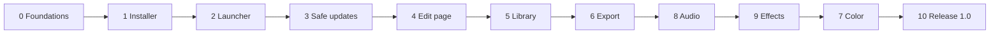

# Kiria — Build Plan

> Copied into the repository on 10 November 2026. From now on this file is the one to keep up to date; change it in the same commit as the code it describes.

## How to use this plan

Version 1.0 is built in ten phases plus a release phase, in the order they appear here (after phase 6: Audio, then Effects, then Color, then the release, as the owner decided in November 2026; the phases keep their numbers); each phase ends at a gate that must pass before the next one starts. The [project plan](project-plan.md) says *what* the app is; this doc says *how* and *in what order* to build it. The agreed look is in the [mockups](https://claude.ai/artifact/BoWqShTxNag7Q1yD8BoKLr).

**Resuming work (people or Claude):**

1. Find the first phase in the table below that is not "Gate passed".
2. Open that phase and take its first unticked step.
3. Read `CLAUDE.md` and the `README.md` of every folder you will touch before writing code.
4. Finish the step (definition of done in the next section), tick it here, commit.
5. When every step in a phase is ticked, run its gate; only a passed gate, or the owner accepting the phase without it, moves the phase to "Gate passed".

**Changing the plan:** a new idea goes to "After 1.0" at the bottom unless it blocks the current gate. Changing an agreed decision means updating the project plan first, then this doc.



Every arrow is a gate: the phase before it is tested on both machines before the next one starts.

The platform (project file, errors, installs, safe updates) comes before any page, so every page is built on top of something that already can't lose work.

| # | Phase | Builds | Gate (short) | Status |
| --- | --- | --- | --- | --- |
| 0 | Foundations | Workspace, engine core, errors, resources, app shell | Empty app opens, autosaves, recovers from a forced crash | Gate passed |
| 1 | Installer and updates | Signed builds, installers, GitHub releases | A tagged build installs on a clean Windows and Linux machine | Gate passed |
| 2 | Launcher | Project browser, folders, update panel | Create, find and open projects; manual update works | Gate passed (accepted by the owner; manual gate tests skipped) |
| 3 | Update safety | Side-by-side installs, rollback, project migrations | A broken update rolls back by itself; old projects open | Gate passed (accepted by the owner; manual gate tests skipped) |
| 4 | Edit page | Media pipeline, playback, timeline, editing, inspector | Cut a 20-minute game recording smoothly at 1440p 60 | Built; gate waiting for the owner's edit |
| 5 | Library | Import, index, tabs, lists, labels, prune | 500 clips import, filter and search instantly | Built; gate measured on the cloud machine (Library page passed, Edit page borderline), waiting for the owner's PC |
| 6 | Export | Encode pipeline, presets, checks, queue | Exports match the timeline frame for frame | Built; gate measured on the cloud machine, waiting for the owner's PC |
| 8 | Audio | Mixer, effects, loudness, clarity check | A noisy three-track recording mixes to −14 LUFS cleanly | Built; gate waiting for the owner's PC |
| 9 | Effects and extras | Effects drawer, background removal, extra features | Hair edges hold, no flicker; extras pass their tests | Not started |
| 7 | Color | Float pipeline, wheels, curves, scopes, auto white balance | Preview and export colours match; grades copy between clips | Not started |
| 10 | Release 1.0 | Hardening, docs, licence, first public release | Release checklist all ticked | Not started |

## Ground rules and how each task is done

Every step follows the eight working rules in the project plan; the ones that change how code is written are repeated here so they are never missed.

- **Same control, same key, every page.** Shared tools (playhead, edit needle, region, labels, transport, shortcuts) live in one shared module and are reused, never re-implemented per page.
- **Shared visuals stay put.** Top bar, tab position (centred over the viewport), panel widths and theme tokens come from one layout and one theme module.
- **No other product names** in code, comments, docs, commit messages or UI text.
- **Documented folders.** Every crate and every folder with more than a couple of files has a `README.md` (what it holds, how it fits, entry points). `CLAUDE.md` in the root is the map of the whole project. Both are updated in the same commit as the code they describe.
- **Readable over clever.** Small modules, clear names, no `unsafe` outside the FFmpeg and GPU wrappers and the operating-system calls (`crates/os`), no `unwrap()` in non-test code.
- **One name, one place.** The app name, short name, icon and identifiers live in `crates/brand`; nothing else hard-codes them.

### Workflow for a big system

Used for playback, caching, the timeline widget, rendering, the audio engine, background removal, auto white balance and the highlight finder (rule 7).

1. **Research:** short written note in `docs/research/<system>.md`: what the problem is, known approaches, sources.
2. **Prototype two or three approaches** in a throwaway `spikes/<system>/` folder, built in parallel (separate agents or branches), each against the same benchmark and test clips.
3. **Compare** on speed, smoothness, memory, code size and robustness; write the result and the choice into the research note.
4. **Build the chosen one properly** in its crate, delete the spike folder.

### Definition of done (every step)

- [ ] Builds without warnings on Windows and Linux (`cargo clippy -- -D warnings`).
- [ ] Tests for the new behaviour pass; existing tests still pass.
- [ ] Errors use the shared what / why / fix type, never a bare string.
- [ ] No UI-thread blocking: anything over 2 ms runs on a worker.
- [ ] Folder `README.md` and `CLAUDE.md` updated if structure or behaviour changed.
- [ ] Step ticked in this doc; commit message says what and why.

### Test footage

A shared `test-media/` folder (not in git; listed in `test-media/MANIFEST.md` with checksums) holds real recordings from both machines: 1080p 60, 1440p 144, variable frame rate, H.264, H.265 and AV1 from the AMD and NVIDIA encoders, MKV files with 3 audio streams, a 1-hour recording, a facecam clip, and a few deliberately broken files. Every phase gate is run against it.

## Repository layout and tooling

One Cargo workspace, one engine with no UI, and thin pages on top; the UI only sends commands to the engine and reads snapshots back, so a slow decode can never freeze a window.

```text
/
├─ CLAUDE.md               map of the project, rules, where things live, how to run
├─ README.md               public intro, build instructions, licence
├─ Cargo.toml              workspace, shared dependency versions
├─ crates/
│  ├─ brand/               app name, short name, icon, ids (the one place)
│  ├─ diag/                what/why/fix errors, logging, crash reports
│  ├─ project/             project model, commands, undo/redo, autosave journal
│  ├─ jobs/                worker pools, priorities, resource budgets
│  ├─ media/               probe, demux, decode, encode (FFmpeg wrapper)
│  ├─ cache/               RAM, GPU and disk caches, proxies, thumbnails, waveforms
│  ├─ render/              GPU compositor, transforms, colour, effects (wgpu)
│  ├─ audio/               real-time mixer, DSP, meters, loudness
│  ├─ ml/                  model inference (ONNX Runtime)
│  ├─ library/             media index and search (SQLite)
│  ├─ engine/              ties the above together: playback scheduler, export
│  ├─ ui-kit/              theme tokens, shared widgets, top bar, timeline widget
│  ├─ graphics/            which graphics system draws the windows: shared setting, safe start
│  ├─ app/                 the editor window and its five pages
│  ├─ launcher/            small separate binary: projects + updates
│  └─ updater/             release check, signature check, install, rollback
├─ docs/
│  ├─ research/            one note per big system (rule 7)
│  └─ decisions/           short records of decisions that changed the plan
├─ spikes/                 throwaway prototypes, deleted after a choice
├─ xtask/                  project chores: `cargo xtask check-media`
├─ tests/                  cross-crate and golden-frame tests
├─ test-media/             not in git, see MANIFEST.md
└─ .github/workflows/      CI and release pipelines
```

### Tooling

| Need | Choice | Notes |
| --- | --- | --- |
| Language | Rust stable, edition 2024 | Pinned with `rust-toolchain.toml` |
| Lint and format | `cargo clippy`, `rustfmt` | Warnings fail CI |
| Tests | `cargo nextest`, `proptest`, `insta` snapshots | Golden frames compared with a tolerance |
| Fuzzing | `cargo-fuzz` | Demuxer input and project files |
| Benchmarks | `criterion` | Tracked per commit, regressions fail CI |
| Licences | `cargo-deny` | Blocks dependencies with incompatible licences |
| Release | `cargo-dist` + GitHub Actions | Builds, signs and uploads on every tag |
| Profiling | `tracing` + Tracy | Spans on every job, frame and command |

### CI on every pull request

Windows and Linux runners: format check, clippy, tests, licence check, a 30-second playback benchmark on a reference clip. Tags `v*` additionally build installers, sign them and draft a GitHub release.

Linux is paused in CI and in releases since November 2026 (Windows only for now); the workflows keep the Linux steps and say how to turn them back on.

## Phase 0 · Foundations

Phase 0 builds everything later phases stand on and that is painful to add afterwards: the versioned project file, undo, autosave, explained errors, resource budgets and an empty themed window. No video yet.

**0.1 Repository and CI**

- [x] Create the GitHub repo, workspace `Cargo.toml`, `rust-toolchain.toml`, `.gitignore`, empty crates from the layout above.
- [x] Write `CLAUDE.md` (rules, layout, how to build, how to resume via this doc) and a `README.md` in every crate.
- [x] CI workflow: fmt, clippy, tests and cargo-deny on Windows and Linux (switch to nextest when the test suite grows).
- [x] `crates/brand`: name "Kiria", short name, app id, icon path; one unit test that nothing else contains the name string (grep test).
- [x] `test-media/MANIFEST.md` and a script that checks the files and checksums are present.

**0.2 Errors and logging (`diag`)**

- [x] `AppError { what, why, fix, action: Option<FixAction>, source }` with a builder; every crate returns it.
- [x] `tracing` setup: rolling log files in the user's data folder, 7 days kept.
- [x] Panic hook: writes a crash report (log tail, versions, GPU, OS) and marks the session as crashed.

**0.3 Project model (`project`)**

- [x] Data types: Project, Sequence, Track (video/audio), Clip, MediaRef (path + fingerprint), TimelineLabel, Region, edit needle position.
- [x] Time as rational numbers (`frames / rate`), never floats; frame-rate conversion helpers.
- [x] Persistent data structures (`imbl`) so a snapshot is a cheap clone.
- [x] Project file: RON with a `format_version` field from day one, written atomically (temp file, then rename).
- [x] Migration framework: one function per version step, tested with a stored v1 sample file.

**0.4 Commands, undo and autosave (`project`)**

- [x] Every change is a `Command` applied to a snapshot; undo/redo is a stack of snapshots.
- [x] Autosave journal: append each command to `project.journal`; full save every 30 s and on idle.
- [x] Recovery: on open, if the journal is newer than the save, replay it; offer "Recover" or "Open last save". (The engine side is done; the prompt itself is drawn by the launcher in 2.3.) Since the mistakes pass the journal holds the whole session from a copy of the file as opened (`<file>.journal.start`), so undo and redo after a full save recover exactly too (a property test crashes random sessions with saves at random points); "Open last save" keeps each set-aside journal under a name of its own. The editor says how many changes came back (each can be undone) and offers the last save in one undoable step, or says where set-aside work was kept.
- [x] Property test: random command sequences + undo/redo always leave a valid project.

**0.5 Jobs and resources (`jobs`)**

- [x] Thread pools for decode, render, analysis and export; one thread always kept free for the UI.
- [x] Priorities: playback > interactive > background; background jobs pause while playing (setting).
- [x] Budgets for worker threads, RAM cache and disk cache, read from settings with Auto defaults.
- [x] Live usage numbers (CPU, GPU, RAM) published for the top-bar readout. (GPU use is filled in once the GPU layer exists.)
- [x] Full saves run on a worker: the interface hands out a snapshot, numbered journal entries make sure nothing is lost or applied twice. (Since the mistakes pass: Ctrl+S goes the same way; saves of one project write one at a time and an older snapshot never replaces a newer file; each write has its own temporary file.)

**0.6 App shell (`ui-kit`, `app`)**

- [x] wgpu + egui window; Ash and Carbon theme tokens copied from the mockups; Inter and a monospace font bundled.
- [x] Shared top bar: project name left, page tabs centred over the viewport position, search button, resource readout, settings cog.
- [x] Empty pages for Library, Edit, Color, Audio, Export that switch instantly.
- [x] Shortcut system: one table of actions and default keys (Space, S, Delete, Backspace, M so far), used by every page.
- [x] Settings window skeleton: theme, resources, "Edit at the playhead".
- [x] Inline error display component (what / why / fix + button) and a Diagnostics panel listing the session's errors.

**Gate 0**

- [x] A new project opens, a dummy command changes it, undo and redo work, the file saves and reopens.
- [x] Killing the process mid-edit and reopening recovers every change.
- [x] An old-format sample project migrates and opens.
- [x] The window stays at the display refresh rate while a fake 8-second job runs in the background. (`--responsiveness-test`: slowest interface work 12.5 ms per frame on a software renderer; runs in CI.)
- [x] CI is green on Windows and Linux.

## Phase 1 · Installer and updates

Phase 1 makes every tagged commit a signed, installable release that the app can find and verify, so both of you run real builds from the first weeks instead of compiling locally.

**1.1 Packaging**

- [x] FFmpeg: a shared-library build (LGPL or GPL, both fit the project's GPL-3.0 licence) pinned to one version, fetched by a build script and bundled next to the binaries (Windows DLLs, Linux AppImage libs). Licence texts shipped in `licenses/`.
- [x] A Windows per-user installer (Inno Setup, see decision 0002) and a Linux AppImage, each containing both `app` and `launcher`.
- [x] Install layout: `<install>/versions/<x.y.z>/` holds each version; `<install>/launcher` stays outside it (needed for phase 3).
- [x] Start-menu / desktop entry points at the launcher, never directly at the editor.

**1.2 Signing**

- [x] Generate an ed25519 release key; private key only in GitHub Actions secrets, public key compiled into `updater`.
- [x] Release workflow signs a `manifest.json` (version, channel, file hashes, minimum launcher version).
- [x] Windows code-signing certificate: skipped for a hobby project (decision 0002); `RELEASING.md` explains the SmartScreen warning.

**1.3 Release check (`updater`)**

- [x] Query the GitHub Releases API with a 3-second timeout; Stable and Beta channels (Beta = pre-releases).
- [x] Download in the background with resume; verify every hash and the manifest signature before anything is unpacked.
- [x] Settings stored: automatic updates on/off, skipped version, channel.
- [x] Every failure becomes a what / why / fix error (offline, rate-limited, bad signature, disk full); none of them blocks opening.

**1.4 Release routine**

- [x] `RELEASING.md`: bump version, changelog entry, check CI, start the release; it publishes itself.
- [x] Version scheme: `0.x.y` until 1.0; the project file format version is separate and only goes up.

**Gate 1**

- [x] Tag `v0.1.0`: CI builds, signs and publishes a release with no manual steps. (Done 10 November 2026: draft "Kiria 0.1.0" with installer, AppImage, update package and signed manifest.)
- [x] The installer works on a clean Windows 11 machine and the AppImage on a clean Linux machine. (Automated: every release installs, starts and uninstalls on a fresh Windows runner and starts the AppImage on Ubuntu 22.04. Installed by the owner on Windows 11 on 10 November 2026; the AppImage gets its first run on your own Linux PC when Linux work starts.)
- [x] A tampered download is refused with a clear message.
- [x] With the network unplugged the app still starts within 4 seconds. (The launcher starts the editor before checking; measured under 0.1 s with no network.)

## Phase 2 · Launcher

Phase 2 builds the launcher exactly as in the agreed mockup: name and logo centred on top, folder tree on the left, a 3-wide project grid, and the version panel bottom left with Update, Skip this version and Automatic updates.

**2.1 Project index**

- [x] Small SQLite file in the user's data folder: known projects, path, thumbnail, length, settings, last opened, folder. (`crates/project-index`; thumbnails are read from beside the project file once the editor writes them.)
- [x] Projects found by: created here, opened from disk, or found in a watched project folder.
- [x] Reading a project's summary never loads the whole project (summary block at the top of the file). (`project::file::read_info` stops reading where the project starts.)

**2.2 Layout**

- [x] Top bar from `ui-kit` with the name and logo from `brand`, centred; settings cog right.
- [x] Left: folder tree with three groups (Projects, Media folders, Other folders) and "+ Add folder". Media folders are remembered for later import.
- [x] Main: "All projects", search, Open…, New project; 3-wide grid of 16:9 thumbnails, scrolling down; each card shows length, resolution, frame rate, last used and any issue line.
- [x] Bottom left: version, "x.y.z available", Update, Skip this version, Automatic updates tick box (wired to phase 1).

**2.3 Behaviour**

- [x] Choosing where projects are saved: a default folder (Settings, or right-click a folder) and Browse… for any folder in New project.
- [x] New project dialog with presets: Game clip (1080p 60), High frame rate (1440p 144), Vertical short (1080×1920 60), Match the first clip. (Changed in 4A: Automatic is the default and the others are optional templates.)
- [x] Issue checks before opening: file saved by a newer version, file damaged, project file missing. (Missing media with a relink suggestion moved to 4A, where importing arrives.)
- [x] Crash recovery prompt (from phase 0) shown here when the last session crashed. (Also on the card and when opening any project with unsaved crash work.)
- [x] Opening a project starts the editor process with the project path, then the launcher closes.

**Gate 2**

- [ ] Cold start to a usable launcher in under 1 second on both machines.
- [ ] Create, rename, move to a folder, search and open projects; 200 fake projects scroll smoothly.
- [ ] Newer-version, damaged and missing-file issues show on the right cards.
- [ ] Update, Skip and the Automatic tick box behave as labelled against a test release.

## Phase 3 · Update safety

Phase 3 makes a bad update harmless before real projects exist: new versions install beside the old one, a version that fails to start is rolled back by itself, and project files only ever move forward through tested migrations.

Automatic test builds (added in Phase 2 so features can be tried through updates): every push to `main` publishes a beta like `0.1.1-beta.12`, and beta builds follow betas.

**3.1 Side-by-side install**

- [x] New version unpacks to `versions/<new>/`; a small `current` pointer file switches only after unpacking and verifying. (`updater::apply`; the signature and checksum are checked again right before installing.)
- [x] Keep the previous two versions; delete older ones after a successful start.
- [x] "Use on next start" by default; "Update now" only when no project is open. ("Restart to update" in the launcher, which never has a project open.)

**3.2 Health check and rollback**

- [x] The editor writes "started OK" once its first window has drawn; the launcher waits up to 20 seconds.
- [x] Two failed starts in a row: switch the pointer back, mark the version as bad, explain what happened, offer to send the crash report. ("Report the problem" opens a new GitHub issue; "Show crash reports" opens the folder.)
- [x] A bad version is never offered again; the next good release is.

**3.3 Launcher self-update**

- [x] The launcher updates itself in a separate, rarer step, using a temporary copy so it can never break its own recovery. (Every version carries its launcher. It replaces the installed one only after that version has started properly, and only if it passes `--self-test`; the replaced launcher is kept aside until the new one has run.)
- [x] Manifest field "minimum launcher version" forces this step first when needed. (`brand::MIN_LAUNCHER_VERSION`.)

**3.4 Project safety across versions**

- [x] Before migrating a project, keep a copy as `<name>.backup-v<old>`.
- [x] A project saved by a newer version opens read-only with an explanation, never silently. (If the newer format changed too much to show, opening is refused with an explanation instead.)
- [x] Migration tests: every released format version has a stored sample that must open in the newest build (added to CI from now on). (`crates/project/tests/samples.rs`, run by `cargo test` in CI.)

**Gate 3**

- [ ] Ship a deliberately crashing test release on the Beta channel: both machines roll back on their own and show why.
- [ ] Pull the power during an update: the next start works on the old version.
- [ ] Sample projects from every earlier format version open, and a backup copy exists.

## Phase 4 · Edit page

Phase 4 is the heart of the app and the longest phase, so it runs as three parts with a checkpoint each: 4A plays media smoothly, 4B edits it on the timeline, 4C completes the page and its extras. Every shared timeline part (playhead, edit needle, region, labels, ruler, transport) is built once in `ui-kit` here and reused by Color and Audio later.

### 4A · Media and playback

- [x] **Probe and import:** container, streams, codec, frame rate, duration, rotation; MKV files with several audio streams import one track per stream, named after the stream. (`media::probe`; `Command::Import` places a file at the end of the timeline as one step; Ctrl+I, the Import button or dropping files. Project format 2 stores the streams.)
- [x] **Automatic project settings:** "Automatic" is the New project dialog's default and the presets become optional templates. In an Automatic project the first video imported sets size, frame rate and audio rate as one undoable step, and the app says what it chose; later clips are fitted, never change the settings silently. Settings stay changeable in the project. Project format change with a migration and a stored sample. (Project format 3; the launcher's dialog and cards; Timeline settings… on the Edit page.)
- [x] **Variable frame rate:** detect it on import, conform to the nearest constant rate, show what was done; audio must not drift over a 1-hour file. (`media::timing` reads packet times at three places; frames and sound are placed by their timestamps, so the drift check over a 1-hour file belongs to playback's checkpoint.)
- [x] **Decoding** (research workflow): hardware decode via D3D11VA / Vulkan Video / VAAPI on AMD and NVIDIA, software fallback, frames uploaded straight to GPU textures; compare at least two pipelines on the test footage. (Note and spike in `docs/research/decoding.md`. Built: GPU decoding with a copy back, CPU fallback per file, frames found by timestamp. The zero-copy path follows once measured on the test machine. Done towards it, step 1 of 3: on Windows the launcher's and the editor's windows draw through Vulkan, with Direct3D 12 as the fallback when Vulkan reports an error, crashes or freezes at start; after a crash or freeze the window asks whether to keep Direct3D 12 or try Vulkan again; one Graphics setting for both programs, in `crates/graphics`. Colour conversion now happens on the graphics card (step 2 of 3): the viewer uploads the decoder's YUV planes and a shader converts, scales and turns them while drawing; formats other than 8-bit 4:2:0 still convert on the CPU. Step 3 of 3, first half: with Vulkan, the editor opens its device itself with the video decode queues, so the decoder can share it; Diagnostics says which kinds of video the device decodes, or why none. Second half: the viewer's H.264, H.265 and AV1 video is decoded on that device and drawn from the graphics card without passing through system memory (a copy on the card into two plain images the shader samples; the reasons are in the note), falling back per file to the copy-back path and then the CPU; a switch in Settings under Graphics and a crash guard like the one around Vulkan turn it off. To be confirmed on the test machine; 10-bit, Linux and cards with a single queue family still go the older ways.)
- [x] **Audio clock as master:** `cpal` output with lock-free ring buffers; video frames scheduled against the audio clock. (`engine::playback`: the position is the samples played; a wall clock stands in without a sound card.)
- [ ] **Caches** (research workflow): RAM frame cache ahead of the playhead in the play direction, GPU texture cache, disk render cache keyed by input hash; budgets from phase 0. (Note and spike in `docs/research/caching.md`; measured on the cloud machine and on the test machine, where memory plus a proxy answered within 50 ms everywhere. Build order: dropping stale decodes and a key frame index (built: a click never waits for an earlier jump to finish, and a hop past a key frame jumps to it), frames kept after decoding (built for video decoded on the window's graphics device: every frame decoded on the way to a picture stays on the card within a budget, so going back over them is instant, and when idle the stretch before them is decoded too, so stepping back across a key frame is as well; the same for frames in memory is still to do), proxies (built: see the next item), the key frame shown first (built: a jump in a file without a proxy shows the key frame before the moment at once, from a decoder of its own, then the exact frame; Settings › Proxies can say "Wait for the exact frame" instead). Built: where they will show. The timeline has a cache bar, a thin strip under the ruler (`ui_kit::timeline::cache_bar`) that draws ready, being-prepared and waiting stretches from ranges the page passes in. Today the Edit page feeds it only with what really is prepared in the background, the reading of waveforms and clip pictures, and marks nothing as ready: pictures for playback are still decoded as they are needed, so a green stretch would promise smooth playback that nothing guarantees. To feed it when built: the RAM frame cache (ready where frames are in memory around the playhead), proxies (being prepared while a file's proxy is built, ready when it exists), and the disk render cache and the region's pre-render (ready where rendered). They only add ranges; the widget stays as it is.)
- [x] **Thumbnails, waveforms and proxies** built in the background; proxy Off / On / Auto; export always uses originals. (Waveforms and clip thumbnails done. Proxies done (`docs/research/caching.md`, step 3): 540p H.264 with a key frame every 8 frames and exactly the original's frame times (`media::proxy`), kept in the app's cache folder by the recording's fingerprint (`cache::proxy::Shelf`; per recording and shared between projects, so not in `project::side_files`), the ones used longest ago dropped to stay inside the disk budget. Built one at a time on the analysis pool, newest file first, waiting while the timeline plays (also in the middle of a file); the original is decoded on the GPU's decoder when it can be, and the encoder is the graphics card's when one opens and keeps the frame times, else the CPU's. Settings › Proxies: Auto (the usual) builds one for a file in which a jump can't make 50 ms, judged from its key frame distance and a decode timed on a worker; On builds one for every video file and shows proxy frames only; Off builds and shows none. While scrubbing or jumping the proxy's frame is shown first and the exact one when the playhead rests (unless the frame is kept already); the viewer's corner says "proxy frame". The media drawer says "Needs proxy", "Proxy 43 % · 2 min left" or "Proxy" under each file, and its right-click menu has "Build proxy now" and "Delete proxy". Export never reads proxies (a test exports through a shelf whose proxy shows another picture). Not yet: the timeline's cache bar marking proxies, a proxy for a single clip rather than its file, clearing the cache with one button. While a file's sound or pictures are being read the timeline says so: each clip still waiting has a slim bar with the percentage and, once it can be told steadily, the time left; an audio clip's waveform fills in from the left as the reading goes; the track's name has "Reading 43 %" beside it until all its clips are done; clips whose reading failed say "no waveform" or "no pictures". Jobs report progress through `jobs::JobContext::set_progress`, one atomic number per job, which proxies and exports can use too. Closing the app or relinking a file stops readings still under way.)
- [x] **Project thumbnails:** the editor writes one on every save; the launcher's cards show it (moved here from phase 2: there is no picture to show before playback). (Done: the frame at the playhead, written on a worker after each save and on closing; the launcher reads it on a worker.)
- [x] **Missing media:** the launcher's cards and the editor say which clips are missing and suggest relinking them (moved here from phase 2: there is no media before importing). (Done: the Edit page says which files are missing, marks their clips, and finds them in a picked folder by fingerprint, even renamed; the launcher's cards count them.)
- [x] **Preview quality:** Full, 1/2, 1/4, Auto; drop resolution before dropping frames; the viewport says when and why. (Auto lowers to 1/2 and then 1/4 while playing when pictures arrive late, and the viewer's corner says so; full again when paused. Since colour conversion moved to the graphics card, that lowering only applies to pictures still converted on the CPU; the others come at the nearest halving of the file's size that fills the size wanted, which costs the same at any setting.)
- [x] **Viewport and transport:** single view, Display menu, preview-resolution dropdown, zoom; floating squircle transport with play centred; pause returns to where playback started, stop holds; Space plays/pauses. (Done: preview-resolution menu, the floating transport, Space, pause back to start, stop holds. A handle between the viewer and the timeline shares the height between them: drag it down for a taller viewer, up for a taller timeline, double-click for the usual split; kept in Settings, and a shared part (`ui_kit::splitter`) for the Color and Audio pages to use. The Display menu (split view, the viewer in its own window, full screen, and the timeline's ways of looking at tracks). Zoom (`ui_kit::viewer::Zoom`): Fit (the usual) or a scale, 100 % being one timeline pixel on one screen pixel; Ctrl+wheel over the picture zooms at the pointer (zooming out stops at Fit on the way), a drag with the middle button pans a zoomed picture with the grabbing hand, and the frame always covers the viewer along a side where it is larger. The zoom menu beside the preview quality says the scale ("Fit · 47 %", "200 %") and offers Fit, 50 %, 100 %, 200 %, Zoom in and Zoom out; four commands in the shortcut table: Ctrl with = (or +) zooms in, Ctrl+- out, Ctrl+0 is 100 %, Shift+Z fits (the plain = and - stay the timeline's). The toolkit's own zoom of the whole interface on Ctrl with =, - and 0 is turned off for every window (`ui_kit::setup`); there is no interface scaling setting yet (the project plan's "interface scaling for high-resolution screens" is still to come). Only the part of the picture that is seen is drawn (a picture past the window's edge would be squeezed into it), the handles on the picture line up with the zoomed frame, and on Auto the picture is asked for at the size it is shown, up to the timeline's. The zoom is view state for the session, the Program only: the split view's Source and the viewer's own window show the whole picture.)

**Checkpoint 4A:** a 1440p 60 H.265 recording plays in real time on both machines, scrubbing shows a frame within 50 ms, and a 1-hour VFR file stays in sync to the end.

### 4B · Timeline and editing

- [x] **Timeline widget** (research workflow): one custom GPU-drawn widget, not stacked UI elements; video area and audio area with separate vertical scroll, a draggable divider, shared ruler starting at 00:00:00:00, bottom scroll bar with zoom. (`ui_kit::timeline`; measured in `docs/research/timeline.md`.)
- [x] **Moving around the timeline:** zoom in for fine work and out for the whole edit, pan sideways, scroll each area, the same over the ruler and both areas. (Done: Ctrl+wheel or a pinch zooms time and keeps the moment under the pointer in place; `=`, `+` and `-` zoom in and out around the playhead; `\` shows everything. Shift+wheel, a sideways wheel or two fingers on a touchpad pan; the plain wheel scrolls the area under the pointer and pans over the ruler and the scroll bar; dragging with the middle button pans time and scrolls the area it began over. Zoomed all the way in, a frame is at least 40 points wide at any frame rate and the ruler has a mark on every frame. Ctrl+wheel and Shift+wheel had stopped working: the interface library hands them over as a zoom factor and as sideways scrolling, which the widget now reads; input tests cover every gesture.)
- [x] **Clips:** video clips share one fill with a label-coloured top edge; each audio track has its own colour; waveforms drawn from the cache. (Done: shared fill with a top edge, a colour per audio track. Waveforms are read once per stream by `cache::waveform`.)
- [x] **Edit commands** (all undoable): insert, overwrite, move, trim, delete (Delete, leaves gap), ripple delete (Backspace, closes gap), split (S: selected clip's video and linked audio, or every track when nothing is selected). (Done: insert and overwrite at the edit point from the media drawer's right-click menu, dragging a file onto the timeline (over what's there on the track it lands on, its sound where there is room; Ctrl inserts), move and trim by dragging, delete, ripple delete, split.)
- [ ] **Tools as icons:** select, blade, ripple, roll, slip, slide, text; magnetic snapping (N). (Done: select (V), blade (B), ripple (R), roll (T), slip (Y), slide (U), snapping (N). The text tool comes with titles.)
- [x] **Red edit needle:** separate from the playhead, draggable, its timecode beside the playhead's; cuts, splits and pastes happen there; setting "Edit at the playhead" merges them. (Dragged by its handle in the ruler; its timecode in red beside the playhead's.)
- [ ] **Region:** dragged in the ruler; filled half-circle handles, muted bar, everything outside darkened; loop (L), pre-render, reuse as export range. (Done: Shift-drag in the ruler, round handles, darkened outside, loop with L, set to a clip or cleared from the right-click menu. Pre-render and export range wait for the caches and the Export page.)
- [ ] **Timeline labels:** right-click menu and M place one at the edit needle; Labels row under the ruler; label the region; search finds labels. (Done: M, the right-click menu, the Labels row, search jumps to them; click a label to go there, double-click to rename, recolour or remove it. Labelling the region comes with the Export page's ranges.)
- [x] **Rough cut view:** Display › Timeline: Full / Rough cut; one strip per clip with picture and sound together. (Done: Ctrl+Shift+T or the toolbar; each video clip shows its pictures with its linked sound underneath, sound that belongs to a picture leaves the audio area, and every tool works the same. Kept in Settings.)
- [x] **Track headers:** per-track horizontal fader, mute, solo; master column right of the timeline whose meter is also the fader, with LUFS and true peak. (Done: mute, solo and a volume fader on audio tracks; a level button beside them that shows a line across each clip of the track at the clip's volume, dragged up or down for that clip's volume (+12 dB at the top, Off at the bottom, one undo step, double-click for 0 dB; which tracks show it is view state); waveforms grow and shrink with each clip's and its track's volume, live while the fader moves; the master column with a meter that is also the mix's fader. Loudness and true peak are measured on the audio thread as the international broadcast loudness recommendation describes (`engine::loudness`: K-weighting; momentary 0.4 s, short-term 3 s, and integrated loudness gated at -70 LUFS and 10 LU under the rest, counted in a histogram so nothing is allocated while playing; the true peak from four-times oversampling), tested against the standard's reference tones. The meter shows each channel's sample peak with a line at its true peak (red over -1 dBTP) and a third lane with the short-term loudness and a line at the loudness aimed for (-14 LUFS for online video unless another is chosen, in the column's right-click menu or in Settings › Audio, the same setting either way: -16, -23, -24 or none). Under it M, S, I (integrated since playback started, so looping the region measures the region; green within 1 LU of the target, yellow louder) and TP (the highest true peak since then); both stay readable after playback stops and a click on them starts them again. An export measures its sound as it writes it and says its integrated loudness and highest true peak when done. On the Edit page I and TP start again with every play; the Audio page's full loudness overview (8.4) offers other ways to count. Later: a loudness history graph. Measuring a stretch without playing it came with export's loudness normalisation (6.1).)
- [x] **Track heights:** every track as tall as the work needs: tall audio tracks for fine waveform work, tall video tracks for bigger pictures. (Done: drag the edge of a track's name, the bottom edge of an audio track and the top edge of a video track; double-click it for the usual height; Alt+wheel, or Alt with `=` and `-`, makes every track of the area under the pointer taller or shorter and Alt+`\` puts them back; 28 to 400 points. Waveforms, pictures, the rough cut view, scrolling and every tool follow the heights. Heights are view state, not edits: no undo step, no unsaved change. They are kept with the divider between video and audio in `<project file>.view` beside the project, so they come back when it is reopened, need no change to the project format, and a project without the file simply opens with the usual layout.)

**Checkpoint 4B:** cut a 20-minute recording into a 3-minute edit using only the keyboard shortcuts, undo the whole session step by step, and the timeline never drops below the display refresh rate.

### 4C · Page completion and extras

- [x] **Compositor** (`crates/render`): the timeline's picture put together on the GPU from every visible layer (place, crop, opacity, quick colour), at the timeline's size; the viewer shows it and export will read it. Everything below that changes the picture is built on it. (Done: researched, measured on the test machine and chosen, `docs/research/rendering.md`. The preview worker decodes every layer that is seen and puts them together in linear light on the window's device (`engine::frame`, `engine::compose`, `render::Compositor`); the viewer shows that one frame, in the timeline's shape. A clip that doesn't fill the frame gets bars and lets lower tracks show; layers hidden by a frame-filling clip are never decoded. Still to do: place, crop, opacity and quick colour per clip (the inspector, next); the saved frame and the project's picture still show the top clip alone; a window not drawn on a graphics card shows the top clip alone.)
- [x] **More tracks:** any number of video and audio tracks, so the layers the compositor puts together can be reached: add and remove tracks, hide a video track, move clips between tracks, drop files on a chosen track. (Done: right-click the column of track names to add a video track (on top: V2 covers V1) or an audio track (at the bottom), named by the next free number; both are also commands in the shortcut table and in search, without keys until someone gives them some. The same menu renames, hides and removes the track under the pointer; a double-click on a name types a new one in place. Only an empty track can be removed and the last track of a kind stays: the menu's line is greyed and says why, and the command refuses with the same explanation, so removing a track never removes clips. A video track's header has an eye: hidden, its clips are dimmed on the timeline and left out of the picture. A clip dragged up or down lands on the track of its kind under the pointer and is drawn there while it is dragged; sideways movement and snapping work as before, its linked clips move sideways on their own tracks, and the whole drag is one undoable step, refused with nothing changed where any of them would overlap. A file dragged from the media drawer goes on the video track under the pointer, over what is on the tracks it lands on (other tracks keep what they have, so the picture under it stays); with Ctrl it is inserted and every track moves later. All in the shared timeline widget and as commands of their own, without a change to the project format. Then, layers without losing sound: a file dropped on a track (and the media drawer's "Overwrite at the edit point", which is a drop on the first video track) replaces what its picture covers on that track only, with the sound belonging to it when the file has sound of its own; each of its sound streams takes the first audio track where that stretch is free, counting from the track an import would give it, and a track is made (named by the next free number) when none is, so nothing else is cut. A clip dragged to another track keeps its linked sound where that has room, and sound in the way moves to the first free audio track the same way. Dragged clearly past the top video track (or under the bottom audio track) a clip goes on a new track made there: a lit "New track" strip shows where while it is dragged. Each of these is one undo step. A dragged clip that would be refused is drawn in the warning colour, with the "not allowed" pointer, before it is let go. The status line says where sound went and which track was made. The video area grows to show its tracks (the audio area keeps three tenths of the height) and gives the room back when a track goes; a track just added is scrolled into view; dragging the divider still works, and where it was dragged to hide tracks it stays until a video track is added. A removed track's height comes back when its removal is undone. New commands (`LayMedia`, `MoveBetweenTracks`), so older journals replay as before. Still to do: adding a track at a chosen place and reordering tracks; locking a track; the timeline does not scroll by itself while a clip is dragged to a track out of view; while a picture is dragged to another track its linked sound is drawn where it was, not where it will go; in the rough cut view an empty audio track is not shown.)
- [x] **Timeline views for many tracks:** under a Timeline heading in the Display menu, for productions with twenty video and twenty audio tracks: compact tracks, the divider between video and audio taken away, and a choice of what a click on the timeline moves. (Done: **Compact tracks** draws every track, video and audio, as a strip 18 points tall that still shows each clip's colour and name (centred), the track's name, the eye of a video track and M and S of an audio track; pictures, waveforms, fades, level lines, the level button and the fader are left out, as they would not read. Selecting, moving (also to another track), trimming and every tool work as before. The heights given to tracks are not touched: dragging a track's edge, Alt+wheel and the height commands wait (the status line says so), and turning it off brings every height back. **Divider between video and audio**, turned off, makes the video and audio tracks one list that scrolls together (video on top, V1 lowest, audio right under it, a hairline between them), with nothing to drag; the wheel and the middle button scroll the whole list, a clip still moves only among tracks of its kind. Turned on, the divider is where it was and each area scrolled as before. Both are commands in the shortcut table and in search, without keys until someone gives them some, and kept in settings (a way of working, the same for every project; nothing in the project or its `.view` file, no undo step). The layout sums are pure functions (`ui_kit::timeline` `track_views`). **Clicking the timeline moves** the playhead (as before) or the edit needle: in Settings (Editing) and as the Display menu's third Timeline line and a command. Set to the edit needle, a click in the ruler or the labels row puts the needle there and a drag takes it along, putting it down where it is let go; the playhead is moved by dragging its head at the top of the ruler, which is then drawn larger with grip lines and lights up when pointed at (it is a handle in both settings; Shift still begins a region there). Shift+drag regions, labels, clips, empty track space (a click selects nothing) and the keyboard are unchanged. With Edit at the playhead there is no separate needle, so a click moves the playhead and the Settings row is greyed with the reason. **Alt+click** anywhere on the timeline (the ruler, the labels row, empty track space or a clip) moves the playhead to the frame under the pointer whatever the setting, with every tool: it never selects, cuts or trims, and the selection stays. Alt+drag keeps its meaning on clips, their edges and keyframe diamonds (no snapping); in the ruler or on empty track space it scrubs the playhead, a frame at a time. Both are in the Mouse section of the shortcuts page, and the playhead's handle says so in its tooltip.)
- [ ] **Inspector** (right, fixed width): Transform, Crop, Quick color, Speed, Effects, Audio; one-line summaries in collapsed headers; keyframe diamonds. (Done: the panel on the right of the Edit page for the selected clip, with Transform (position, size, turn, opacity, Fit and Fill), Crop, Quick color (exposure, contrast, saturation, temperature, tint), Speed (one speed or a ramp, and frame blending: see Slow motion below) and Audio (volume -60 dB, which is silent, to +12 dB; pan with equal power; fade in and fade out on whole frames, on a quarter-sine curve, drawn on the clip in the timeline and heard in playback and export); headers say what is set in one line and offer Reset; a drag shows in the viewer at once and is one undo step. Each clip's values are its `look` in the project file (format 8), in millionths, and its `sound` (format 9). A picture's Audio sets all the sound linked to it together; a sound clip selected alone shows Speed and Audio only. A split keeps volume and pan on both halves, the fade in on the left and the fade out on the right. The inspector sits beside the viewer and the timeline below runs the whole width; with nothing selected it describes the timeline. The selected clip's picture can also be taken hold of in the viewer: see Facecam layouts below. Keyframe diamonds: every number of Transform, Crop and Quick color can change over time. A diamond at the end of its row (Position has one for X and Y together) is hollow while the number doesn't change over time, filled when a keyframe is at the playhead and hollow with a dot between keyframes; a click adds a keyframe at the playhead (the first one makes the number change over time) or removes the one there, a right-click on a filled one chooses how the value goes on to the next (linear, the usual; hold; smooth), and arrows beside it move the playhead to that number's previous or next keyframe. The numbers shown are the clip's at the playhead; changing a number that has keyframes, in the panel or by the handles on the picture, writes a keyframe at the playhead, and a drag is one undo step. Section summaries say which numbers change over time, and Reset also removes their keyframes (its tooltip says so). Turning and cropping by handles on the picture: a round turn handle on a short stem off the picture's own top edge (inside the picture when there is no room above it) turns it about the middle of what is seen, landing on upright and quarter turns within 2° (Alt skips that) and in steps of 15° with Shift, the pointer a drawn turning arrow and the turn written beside it; a bar on the middle of each side crops that side, measured along the picture so it works turned, the whole picture shown in the viewer with what is cut off veiled while dragging, the side snapping to the frame's edges and centre lines when it lies along them; one undo step per drag, and keyframes at the playhead for numbers that change over time. The selected clip shows its keyframes as small diamonds along its bottom edge on the timeline; clicking one moves the playhead there, and Alt+Left and Alt+Right (commands in the shortcut table, "previous keyframe" and "next keyframe") step between them. A mark (all the keyframes of one frame) can be dragged along its clip a frame at a time, snapping to the playhead and the clip's other marks (Alt: no snapping), with the viewer showing the picture as it would be while dragging and one undo step on letting go; dropped where a number already has a keyframe it is shown refused and refused with the reason, and onto another number's mark the two join. Shift-click or Ctrl-click chooses several marks, which move together; the tooltip of a mark names its numbers, and its right-click menu goes there, removes its keyframes or sets how they go on (linear, hold, smooth), each one step for every chosen mark. A mark on a clip's first or last frame is drawn whole inside the clip. A drag that starts in the strip along the selected clip's bottom edge, away from a mark, draws a box that chooses the marks inside it (with Shift or Ctrl, adds them to those chosen; higher up the clip a drag still moves the clip). Copy (Ctrl+C) copies the chosen marks' keyframes, every number keyed there with its value and ease, spaced on the timeline from the first; Paste (Ctrl+V) puts them at the playhead on the selected picture clip, the same clip or another, in this timeline or another, as one undo step, and chooses the pasted marks. A pasted number replaces its keyframe already in that frame (other numbers there stay, so marks join); marks that would land past the clip's ends are left out, the rest pasted, and the status line says how many were left out (a paste where none fits is refused with the reason). Both are commands in the shortcut table; in a text field the keys copy and paste text as before (`PasteKeyframes`, a new command, so older journals replay as before). Keyframes are kept in the clip's file time (format 10, `keyframes` per clip), so they stay on the picture through moves, trims, slides, rolls and speed changes; a split gives each half its own keyframes plus one at the cut holding the value there, and templates keep those of the stretch they hold. The viewer, playback and export work out each frame's look from them in whole numbers. Still to do: the Effects section, curves drawn for a number over time, keyframes for volume and pan (a flat level line per clip is on the track headers above; volume and pan lines that change over time are phase 8), fade handles on the clips in the timeline, a drag in the Audio section heard while playing before it is let go, several clips at once; the saved frame and the project's picture don't follow the look yet.)
- [x] **Split view:** Source (raw clip) beside Program (final), off by default, from the Display menu. (Done: a Display menu in the viewer's bottom row, beside the preview quality, with Split view, Viewer in its own window and Full screen; each is a command in the shortcut table and in search (Split view and the own window without keys until someone gives them some; Full screen keeps F). Split view halves the viewer: on the left the Source, the selected clip's file at the playhead's place in the clip, raw (no place, crop, opacity or colour, its own shape), captioned "Source · file"; with the playhead before or after the clip its first or last frame, with nothing selected "Select a clip"; a selected sound clip shows the picture linked to it. On the right the Program, the timeline's picture as before, captioned, with the transport and the handles on the picture. The Source comes from a second preview worker, started when split view is turned on and ended when it is turned off, asked for a project of the clip's file alone (`engine::source`), so it decodes and keeps frames like the viewer's; it keeps a quarter of the frames on the card, and while playing it follows the playhead frame by frame, as the Program does. Each picture draws from a slot of its own in the renderer (`ui_kit::Slot`), so both show at once. Remembered in settings, not in the project. Still to do: a Source with its own transport and in and out points (a source monitor for marking a clip before it goes on the timeline); split view in the full-screen viewer.)
- [x] **Media pool drawer:** left edge tab sliding out a compact media list (full library comes in phase 5) with the Media / Effects switch in place. (Done: the Media tab on the left edge; files by name with a filter, missing ones marked; double-click or + places one at the end of the timeline. Dragging onto the timeline comes with insert and overwrite. Later: the tab sits beside the toolbar and the viewer only, so the timeline runs from the window's left edge to its right, and the open drawer floats over the page instead of pushing it aside: a click on the page away from it closes it, and it steps aside while a file dragged out of it is over the timeline, so the whole timeline takes the drop.)
- [ ] **Search palette** (Ctrl K): clips, labels, timeline labels, commands, settings; shows each command's shortcut. (Done: commands with shortcuts, Settings and Timeline settings, timeline labels and clips (jump there; a clip is also selected). Library clips and labels join with the Library page.)
- [ ] **Slow motion and speed ramps:** speed per clip, ramp keyframes, frame blending; high-frame-rate sources slow down cleanly. (Done so far: a speed per clip from its right-click menu and the inspector's Speed section, 25% to 400%, exact fractions; picture and sound follow it, the sound tape-style. Speed ramps: a clip's speed can change over time, with speed keyframes kept on the timeline from the clip's start (project format 11, `ramp`): the inspector's Speed row has the keyframe diamond (add or remove at the playhead, linear, hold or smooth on to the next, arrows to the previous and next), the speed buttons set the speed at the playhead once there is a ramp, and two buttons make one from the playhead in a click ("Ease into slow motion", "Slow moment": smoothly down over half a second, staying there or for a second and back); "Remove ramp" goes back to one speed. Where the clip is in its file is the ramp added up exactly to the flick (1/705 600 000 s, a whole number for every common frame rate), so preview and export agree and a ramp's steady stretches land exactly on recorded frames; the clip keeps the part of its file it plays and its length follows, to the nearest frame, with linked sound and what comes after moving along; trims, rolls, slides, splits and templates keep the ramp on the picture, a slip keeps it in its place in the clip. Playback, the viewer and export follow the ramp; its sound follows tape-style (the pitch follows the speed as it changes), read at the mixer's rate and resampled per sample. High-frame-rate recordings slow down cleanly: for a recording with more frames than the timeline the Speed buttons offer the speed that shows every recorded frame once (50 % for 120 fps on 60, 42 % for 144 fps), which the ramp buttons slow down to, and at that speed every timeline frame is a recorded frame. Frame blending per clip (format 11, `blend`; Off / Blend in the Speed section): between two recorded frames the compositor mixes them by how near each is, in linear light, from a second picture per layer; exactly on a recorded frame nothing is mixed. A ramped clip shows "Ramp 100→25→100%" by its name and its speed as a thin line along it, and its pictures and waveform follow the ramp. Checked by an export of a recording whose frames show their own numbers. Still to do: keeping the pitch; frame blending when the window has no graphics device to compose with (the top clip is then shown alone, unblended); blending that follows motion rather than mixing; speed keyframes as marks on the timeline (they show as the line on the clip only); several clips at once.)
- [x] **Nested timelines and several timelines per project;** adjustment layers. (Done: project format 12 gives clips a kind: a part of a file, another timeline of the project, or an adjustment layer. **Several timelines:** a tab for each above the timeline, beside its tools (`ui_kit::timeline_tabs`, shared by every page with a timeline): click to open one, double-click to rename it, "+" for a new one the size and rate of the open one, right-click to duplicate, open its settings, place it in the open timeline or remove it; each has its own settings as before. Making, copying, renaming and removing are undo steps (the last timeline, and one that other timelines play, can't be removed, with the reason); which one is open is not an edit: no undo step, kept with the timeline's layout in `<file>.view`, and undo leaves it open. The shortcut table has New timeline and Duplicate the open timeline, without keys until someone gives them some. **Nested timelines:** "Nest the selected clips" (right-click on the timeline, or the shortcut table) moves the clips and their linked clips into a new timeline and lays a linked picture and sound clip playing it in their place; a tab dragged onto the timeline places that timeline there, and "Place in the open timeline" puts it at the end. A nested clip shows the inner timeline's picture, put together at its own size and then placed, cut, turned, coloured and faded by its look and keyframes like any picture, and plays its sound with its own volume, pan and fades; trims, moves, splits, speed and ramps work as for a file. A timeline never ends up inside itself: placing it so is refused with the reason, and a project file with such a loop or a clip playing a missing timeline is reported as damaged. A double-click on a nested clip (or "Open its timeline") opens its timeline. Export renders it, sound included. **Adjustment layers:** "Add an adjustment layer here" on a video track's right-click menu (or at the playhead from the shortcut table) lays one five seconds long on the first free video track from there up, or on a new one on top; the inspector shows its Opacity and Quick color, with keyframes, and its colour applies to everything below it in the picture: what is below is put together first and drawn again coloured, in linear light, at its opacity. Later: other effects on adjustment layers (they come with the effects library in phase 9), nested timelines and adjustment layers in the media drawer's list, and waveforms and pictures drawn inside nested clips.)
- [x] **Facecam layouts:** picture-in-picture and vertical game-plus-facecam presets with on-picture handles. (Done: one-click layouts in the inspector's Transform section for the selected clip: small in any corner (a third of its size, a little in from the edges), and filling the top or the bottom half of the frame, cut to fit, for two pictures stacked on a vertical timeline. Handles on the picture itself: while the playhead is on the selected clip, the viewer outlines its picture (turned and cut as it is) with a square handle on each corner; dragging inside moves it, snapping its centre to the frame's centre lines and its sides to the frame's edges with a thin line shown (Alt, or the timeline's snapping switched off, skips that); dragging a corner resizes it about the opposite corner, the corner snapping to the frame's edges; a double-click fits it. The inspector's numbers follow, and letting go is one undo step. Not in the full-screen viewer. Dragging the round handle above it turns it and the bar on a side crops that side (see the Inspector above). The outline and handles show only when switched on (Q, or "On the picture" in the inspector), so selecting a clip doesn't put a frame around it.)
- [x] **Remove silence:** detect silence on a chosen track, preview the cuts, apply as one undoable command. (Done: Ctrl+Shift+R; threshold, minimum length and edge to keep; found stretches marked red on the timeline; one undoable cut across every track.)
- [x] **Saved versions, templates, thumbnail grab:** named project snapshots, intro/outro templates, save any frame as a full-quality image. (Done: thumbnail grab, Ctrl+Shift+E saves the frame at the playhead as a full-size PNG; saved versions, Ctrl+Shift+V, kept beside the project and restored as an undoable step; templates, Ctrl+T or the Templates… button: Ctrl+Shift+S saves the region, or the whole timeline, under a name as a small file in the app's data folder (its own versioned format, nothing in the project file), and any template drops into any project at the start, the edit point or the end as one undoable step that moves everything later along, makes missing tracks, reuses media the project already has and keeps links; rename and delete from the same window. Not part of templates yet: timeline labels inside the stretch, the tracks' mute and solo, a picture of each template in the list, replacing a template under the same name, and sharing templates as a file with their media.)
- [x] **Comfort:** viewer on a second monitor or full screen, per-project cache cleanup. (Done: F puts the viewer full screen, Escape returns. The second monitor: the Display menu's "Viewer in its own window" (also a command and in search) puts the picture in a window of its own, to drag to another screen; It stays on top of the main window: on Windows a window only gets its turn to draw while no window above it wants to, so under the main window (which draws every frame while playing) it kept its first picture. F there or a double-click fills that screen and Escape gives it back; other keys work there as in the main window; closing it, the same command, or "Bring it back" returns it. Its place and size are kept in settings. It is an egui viewport drawn deferred (its drawing and presenting never count against the main window's interface time) on the same device and queue as the main window, since egui-wgpu shares one painter, and so its paint-callback resources, between windows: the picture is drawn there with no copy, and asked for at the size it is shown there. Meanwhile the main window's viewer says where the picture is, with "Bring it back", and keeps its transport; the inspector and the timeline stay where they are. Not yet: a window kept on a screen that is no longer there is not moved back onto one; turning it on again at the next start; the Source in a window of its own. Cache cleanup: Settings › Cache says what the cache on disk takes for the open project and in all ("This project: 3 MB (1 proxy) · All projects: 153 MB (2 proxies)", measured on a worker when Settings opens and after each clearing), with "Clear cache for this project…" and "Clear all caches…"; each asks first in the shared dialog, saying how much goes and that recordings and project files are not touched. For this project the question offers a choice every time, each with its size: "Only this project's" (the proxies of recordings no other project uses, the usual) or "Also shared ones" (every proxy of its recordings: other projects lose them too). Which recordings other projects use comes from every project the launcher knows (`project_index::Index::known_paths`, those removed from its list too), each file read on the worker: a project file that is gone is passed over, one that is there but can't be read counts as using every recording. The clearing runs on a worker (`cache::proxy::Shelf::clear`: only proxy files in the cache folder, each no longer offered at once and removed once no preview has it open; a build under way is left alone) and the build under way stops. A proxy cleared on purpose is never built again by itself, in this session or a later one: the shelf keeps a list of them (`cleared.txt` in the cache folder, by fingerprint and stream; `Shelf::is_cleared`), Auto and On skip them, the media drawer says "Proxy cleared · build from menu", and "Build proxy now" (any build) takes the mark off. "Delete proxy" in the drawer is on purpose too and sets the same mark. Proxies are the only cache on disk today: waveforms, clip pictures and the frames kept on the graphics card are in memory and go when the editor closes. Proxies belong to recordings rather than projects (shared by every project that uses a file, found by its fingerprint) and are dropped by age within the disk budget, so they don't join `project::side_files`; "this project's" are the proxies of its files. A later cache on disk (the render cache) adds its files to the same measuring and clearing.)
  - [ ] **Keyboard shortcuts page** (Settings, or "shortcuts", "keybinds", "hotkeys" or "keys" in search): visual keyboard drawn for the layout detected from the operating system (Windows keyboard-layout API, Linux xkbcommon), with the right key shapes (ISO, ANSI, JIS) and printed characters, following layout switches live, a dropdown as manual override; shortcuts stored by physical key position so they work on every layout, non-Latin keys showing both their character and the shortcut letter; test on Norwegian, US English, Arabic and Russian layouts; search box, coloured context chips as filters, coloured dots on each used key, dimmed unused keys, Shift / Ctrl / Alt redraws combinations, point to preview and click to pin a key's actions, a Mouse section below; rebinding with clash warnings and a printable cheat sheet, all generated from the one shortcut table. (Done so far: Ctrl+/, Settings or search ("shortcuts", "keybinds", "hotkeys", "keys") open it; a drawn keyboard with used keys tinted and dotted in their context's colour and the rest dimmed, Ctrl / Shift / Alt toggles, point or click a key to see its commands, a search box that narrows the list and lights the keys it finds. Context chips (Anywhere, Viewer, Timeline, While dragging) filter the keyboard, the list and the mouse section. Rebinding: click a command's keys in the list (or pin a key and choose Change…), then press the new keys or click them on the drawing; keys another command has say whose they are and offer Swap or Cancel, so no two commands ever share a combination; Reset per command and Reset all; a command can be left without a shortcut or given one. Changes are in the one shortcut table, so menus, tooltips, hints, search and the launcher show and use them at once; only what differs from the usual keys is kept in settings, by key position. A Mouse section lists wheel, drag, click and held-key actions by context (shown, not changeable). "Cheat sheet…" saves one self-contained HTML page to print: a keyboard picture per modifier combination in use, every command by context with its current keys, and the mouse. The keyboard is drawn in the right shape (ANSI, ISO with the tall Enter and the key by the left Shift, JIS) with the layout's characters, and the US character beside any that differs; built in are US, UK, Norwegian and Japanese. The layout is read from the system and followed live: foreign calls to the system live in a small crate of their own, `crates/os` (the one place besides the FFmpeg and GPU wrappers where `unsafe` is allowed); on Windows it asks for the active layout of the window's thread at most twice a second (one cheap call), on Linux a thread of its own asks the X server's keyboard extension for the active group's layout twice a second (about 15 µs a time, off the interface thread), or without an X server reads `XKB_DEFAULT_LAYOUT`, `/etc/default/keyboard` or `/etc/vconsole.conf` once. The dropdown's first choice, "Automatic (from the system)", is the usual and reads "Automatic: Norwegian"; picking a layout there overrides it, and the system's own is then shown beside the dropdown when it differs; a layout not drawn yet is named and US English drawn. Older settings keep a picked layout, and US (which every older file held) becomes Automatic. Menus, tooltips, hints and search write shortcuts with the characters of the keyboard in use ("Ctrl+-" for Ctrl+Slash on a Norwegian keyboard, "Plus" for a printed +); the page and the cheat sheet add the US name ("Ctrl+- (Slash on a US keyboard)"). Still to do: more layouts, Arabic and Russian among them, with the tests on those; the launcher writes keys with US names (its two hints, Ctrl+F and Ctrl+Comma, read the same on every built-in layout); following switches on Linux without an X server; contexts that are not live together (Color page, Audio page, Menus and dialogs), which is when one combination may do different things in different places.)

**Launcher follow-up (after the edit page)**

- [x] **Delete project:** right-click a card › Delete project…; the confirmation lists the files. The project file and the files that belong to it (journal, backups, thumbnail, timeline layout, saved versions, caches) go to the recycle bin, so a mistake can be undone; imported recordings are never touched. (Done: the list of a project's files is in one place, `project::side_files`; renaming and moving a project now carry them all too. Proxies, the only cache on disk so far, belong to recordings, not projects, so none are listed. A project open in the editor is refused.)

**Gate 4**

*Waiting for the owner's edit* (12 November 2026): the owner agreed that work moves on to phase 5 while the first line below waits for their 20-minute edit; the other two lines are checked as phase 4's building work finishes.

- [ ] Both of you edit a real 20-minute game recording at 1440p 60 to a finished cut without a stutter, crash or lost change.
- [ ] Every shortcut and tool behaves the same in Rough cut and Full views.
- [ ] Performance targets from the project plan are met and recorded in the benchmark history.

## Phase 5 · Library

Phase 5 turns the simple media list from phase 4 into the full Library page; the same index also powers the Edit page's media drawer.

**5.1 Index and search (`library`)**

- [x] SQLite tables: media, types, labels, custom lists, notes, usage in timelines; full-text search across names, labels and notes. Labels, lists and notes are project data (format 13, undoable commands); the index is built from the project in memory on a worker, so it is never the truth and needs no file. Labels can also be offered in every project (names and colours in `labels.ron` in the app's data folder; using one copies it into the project). The drawer's "Find a file" and the search palette ask it; 10 000 files answer every query in a few milliseconds (`crates/library/tests/index.rs`).
- [x] Import checks every file first and explains anything unsupported (codec, damaged, too new) before it reaches a timeline. `media::check`: unknown codec ("too new"), no decoder ("not supported"), first picture or sound unreadable ("damaged"), end missing; a refused file is not added, except that for a recording whose end is missing the person chooses "Import what's there" (at the length really in it, marked "End missing", format 14) or "Skip". Several files at once are summed up in one message; files go into the project 2 ms' worth a frame.
- [x] Media folders from the launcher are watched; new recordings show up on their own. A thread looks through them every 2 s (`library::watch`); a file counts once it stops growing; new files (changed since the project was last saved, not in it) show under "New in your folders" in the media drawer, to add with one click after the import checks. Nothing is added by itself.

**5.2 Page layout (as in the mockup)**

- [x] Same top bar and tab position as every page. (The page sits between a sidebar `layout::LEFT_PANEL_WIDTH` wide and a detail panel `layout::RIGHT_PANEL_WIDTH` wide, so the tabs stay centred over the same place.)
- [x] Left: labels, smart filters, Import, Prune. (Labels with how many files of the open tab have each; a click filters, right-click renames, recolours, offers in every project or removes; labels offered in every project that the project hasn't got show dimmed. Smart filters: Not in a timeline, Needs proxy, End missing, Can't be found, With a note. Prune opens the Prune dialog (5.3).)
- [x] Tab bar: Video, Audio, Images, Effects, then custom lists with "+ New list"; the bar fades and scrolls when full (`ui_kit::tab_strip`; right-click a list to rename or remove it).
- [x] Filter row: label chips, group by, sort, thumbnail size, grid / list switch. (Also "Find" words; group by label, folder or nothing.)
- [x] Video, Images, Effects: thumbnail grid grouped by label, coloured label edge, "In timeline" and "Needs proxy" badges. (A file goes under its first label; the pointer across a thumbnail skims the file; only the lines in view are drawn. Effects says it waits for the effects library.)
- [x] Audio: rows with play button, name, full-width waveform in label colour, format, used-in-timeline mark, duration; grouped by label.
- [x] Detail panel (right, same width as the Edit inspector): preview, mark in/out, add to timeline, metadata, labels, lists, notes; for audio a large waveform, loudness and true peak with one-click fixes. (A small player of its own: a third viewer worker for the picture, the playback engine on a timeline of the file alone for the sound; I and O mark in and out (on the Edit page they set the region); "Add to timeline" adds the marked part as one undoable step; loudness and true peak are measured on a worker and the fix is the level the file's sound is added at, towards the loudness aimed for in Settings and never pushing peaks over -1 dBTP. Each sound stream is measured and fixed on its own. Marks and levels last for the session or, by a setting, are saved in the project: format 15, `MediaUse`, one undo step per change.)

**5.3 Media management**

- [x] Prune: list unused media first, remove it from the project in one undoable step, never delete files from disk. (Done: `Action::Prune`, from the search palette, the media drawer's ⋯ menu and the Library page's Prune button, opens a list of the files no timeline uses (clips in nested timelines, and in timelines placed nowhere, count as use), each ticked with its size; untick to keep. `Command::RemoveMedia` takes them out with their labels, list places and notes in one undo step; nothing on disk is touched.)
- [x] Relink: by fingerprint, automatically when files moved inside a known folder. (Done: when a project opens with files missing, a worker looks for them by fingerprint in the project's own folder and the launcher's project, media and other folders, eight folders deep, 100 000 entries and 20 seconds at most, hashing only files of a missing file's size; what it finds is relinked as one undo step (`Command::RelinkFiles`) and the status line names the files. The rest stay in the banner for "Find them…", which now also relinks in one step.)
- [x] Package project: copy the project plus only the media it uses into one folder (with progress and size shown first) that opens on the other person's machine. (Done: `Action::PackageProject`, from the search palette and the media drawer's ⋯ menu: pick a folder; a new folder named after the project gets a clean save of the project and `Media/` with every file a timeline uses; the dialog shows the files, the size in all and the free space on that drive before anything is written, then copies on a worker with progress, time left and Cancel (nothing left behind). Media paths in the package are relative to its folder (a relative path means "from the project file's folder" whenever a project opens), so it opens wherever the folder goes; checked by moving a package and opening it with the originals gone (`crates/project/src/package.rs`). Saved versions go in only when "Include saved versions" is ticked (asked each time, off at first), with the files only they use. Not copied: the autosave journal, backups, templates and proxies.)

**5.4 After a library-heavy test** (a tester's session of 150 files, November 2026)

- [x] Importing on the Library page fills the project's media only; the Edit page's import still puts each file at the end of the timeline. Several files imported at once onto an automatic timeline settle it on what most of their videos share, not on the first file (a 0.1 s 96×32 test pattern no longer decides).
- [x] Choosing several files on the Library page (Ctrl-click, Shift-click, Ctrl+A) and labelling them, putting them in lists, building their proxies, adding them one after another and taking them out of the project, each one undo step; Select all (Ctrl+A, in the shortcut table) on the timeline too.
- [x] Names for new labels and lists asked in a small dialog (a field inside a menu lost the keys to shortcuts); no shortcut reaches the page while a dialog is up. The search palette is such a dialog: Enter runs the first result, Escape and a click outside close it; it finds Settings' sections ("proxy") and the project's timelines.
- [x] A new timeline is "Timeline 2", renamed by double-clicking its tab; the tabs show on an empty timeline too.
- [x] "New in your folders" and each file's proxy state (badges, "Build proxy now", "Build proxies") on the Library page, shared with the media drawer. Switching Proxies to On builds cleared proxies again; "Build proxies" in search builds every missing one.
- [x] Crash detection per editor process, so two editors on two projects don't take each other for crashed.
- [x] No system file chooser (Linux without the desktop's service or zenity): an explained error instead of nothing.
- Not done: a 150-file import on the Edit page is still one undo step per file (Select all and Delete take them off in one); a rubber band to choose files on the Library grid; closing the window from outside the window manager (the X window destroyed under it) still ends in the windowing library's panic.

**Gate 5**

*Measured on the cloud machine* (13 November 2026; provisional until measured on the owner's PC, so nothing below is ticked): the first line passed there on the Library page and was borderline on the Edit page, with the fixes it called for; the second needs the owner's second PC.

- [ ] 500 mixed files import with live progress while the UI stays smooth; filters and search answer in under 100 ms. (On the cloud machine, two cores and software graphics: passed on the Library page, borderline on the Edit page. The files: 200 H.264 and 100 H.265 videos (MP4 and MKV, 90p to 360p, 1 to 2 s, 39 of them with two or three sound streams), six 1080p videos, 40 WAV, 40 MP3, 30 FLAC, 30 Opus, 25 PNG, 25 JPEG and four broken files, imported at once with `editor big.project --import <folder> --page library --responsiveness-test` (the test lasts until the imports are in). 496 went in and onto the timeline in 8 to 14 s; the four broken ones were refused in one message; "Checking N files…" counted down beside Import on both pages, and the Library's grid filled as they came. Interface time for 99 frames in 100: Library page 5.7 and 6.5 ms (at most 10.9 ms), Edit page 11.6, 11.7, 14.8 and 15.4 ms in four runs, 16.4 and 23.6 ms in two more, against the 16 ms the test allows; the interface's own CPU time was 4 to 5 ms for 99 frames in 100 on both pages, the rest waiting for one of the two cores. Searches on the 496-file project (`GATE_PROJECT=<file> cargo test -p library --test index -- --ignored`): indexed in 5 ms, every kind of query answered in 0.03 to 0.23 ms on the index and in about 0.3 ms asked of the worker the pages ask; the 10 000-file test: indexed in 0.2 s, queries 0.2 to 4.7 ms. Fixed on the way: larger JPEGs were refused as damaged (19 of the 25 photos); the autosave journal waited for the disk on the interface thread, up to 18 ms per imported file; and the analysis workers ran at the interface's priority, so on two cores a frame waited behind them (Edit page 22.8 ms for 99 frames in 100 before, 11.6 ms after). Worth watching on the owner's PC: drawing the Edit page with about 500 clips on the timeline takes about 1 ms of CPU and up to 6 ms at moments.)
- [ ] A packaged project opens on the other machine with nothing missing. (Needs the owner's second PC. On one machine the package test moves a package and opens it with the originals gone, nothing missing: `crates/project/src/package.rs`.)

## Phase 6 · Export

Phase 6 delivers finished files: the full Export page from the mockup, a background queue, and output that matches the timeline frame for frame and sample for sample.

**6.0 Basic export, pulled ahead of the Library** (decided November 2026: until a video can be got out, nothing made on the Edit page can be used; so this one step is built right after the Edit page's inspector, and the rest of the phase keeps its place)

- [x] Export the timeline, or its region, to one MP4 file: H.264 from the graphics card's encoder with a software fallback, AAC sound, at the timeline's size and frame rate. Pictures come from originals through the same compositor as the viewer, sound from the same mixer. It runs on a worker with progress, time left and cancel, and editing continues meanwhile. A small dialog (file, range, quality) stands in for the Export page; presets, the queue, other formats, loudness and the checks are 6.1 and 6.2. (Done: the Export page has the file, the whole timeline or the region, High / Medium / Small with the size each comes to, and the encoder (the graphics card's when one opens, else the processor's); progress says the frame, the pace against real time, the time left and which encoder; Cancel leaves nothing behind. `media::encode`, `render::Reader`, `engine::export`. Measured on the test machine: the graphics card's encoder opened and a 1440p 60 timeline exported at 2.9 times real time, with picture and sound in sync.)

**6.1 Encode pipeline (`engine`, `media`)**

- [x] Render the timeline from originals (never proxies) through the same compositor as playback, at full quality. (Done: the export's preview worker is never handed the proxies and now waits for each exact frame: before, a stretch starting between two key frames could take the key frame before it, shown first in the viewer, as its first frame. Pictures are asked for at the timeline's own size; the viewer's lowered sizes while playing are the viewer's alone. Tested: a stretch starting between key frames starts on its exact frame, and the exported picture is the recording's at full size.)
- [x] The graphics card's encoders first (each vendor's own, and VA-API on Linux) for H.264, H.265 and AV1; software fallback. (Done: `media::encode` tries each codec's encoders in order, the graphics card's, the system's, then the processor's (`libx264`, `libx265` at "veryfast", `libsvtav1` at preset 8); a codec with no encoder is refused with the reason. All aim at a bit rate from the quality (High / Medium / Small), H.265 at 0.65 and AV1 at 0.55 of H.264's for the same picture, so the size shown before export holds whichever encoder opens. 8-bit 4:2:0 only: the compositor's frames are read back as 8-bit planes; 10-bit waits for a 16-bit read-back. `engine::export::Encoders::detect` says on a worker what this machine can encode (each graphics card encoder opened once at 1280×720). The pinned FFmpeg build has every encoder named; on the Linux test machine without a video device the processor's were used.)
- [x] Containers MP4 and MKV; audio AAC, Opus, FLAC; audio-only WAV, MP3, OGG. (Done: MP4 holds AAC or Opus; MKV AAC, Opus or FLAC (FLAC is not offered in MP4: many players don't read it there, and lossless sound with a picture is for keeping, which MKV is for); WAV is 24-bit PCM; MP3 from the LAME library; OGG Opus or Vorbis. Opus is always mixed at 48 kHz, the rate it takes. H.265 in MP4 is tagged so every player that takes it knows it, and MP4s have their index at the front, so they start playing before they have downloaded. The Export page has a format row (container, picture codec, sound codec; what can't be encoded here is greyed); a sound-only file needs no graphics card. Tested: every combination exports a recording's flash and beep together, at the right moment to the sample (within 5 ms) and frame, with every frame and both channels.)
- [x] Loudness normalisation pass (two-pass measure, then apply) and a true-peak limiter on the master. (Done: an export can be normalised to the loudness aimed for in Settings › Audio: the whole stretch is mixed and measured first (integrated loudness, `engine::loudness`), without writing, then exported with the gain that brings it there, at most 20 dB up and none for silence; the master then goes through a true-peak limiter at -1 dBTP (`engine::limiter`: four-times oversampled detection, 1.5 ms look-ahead, 80 ms release, pure and tested on tones, clicks and noise). Off, the mix is written sample for sample. The outcome says what was measured, the gain and how far the limiter went, and the loudness and true peak of what was written. Tested: normalising to -14 and -23 LUFS lands within 1 LU with the true peak under -1 dBTP, as written and as read back. Found on the way and fixed after: the playback mixer jumped in a file's sound on every block when its timestamps were a few milliseconds off its sample count (the game recording in the fixtures: its Opus sound timed 7 ms before the picture because the decoder wasn't told the packets' time base, and rounded to the millisecond), and a jump was not sample-exact, so exported sound of such a file differed from one straight read. Now the decoder counts samples from the first timestamp, times sound from the picture's start, lands a jump on the exact sample a straight read reaches, and the mixer jumps only on a real jump: exported and played sound is the file read straight, to the sample.)

**6.2 Page (as in the mockup)**

- [x] Presets left: Web 1080p, Web 4K, Vertical, Archive master, Small preview, Audio only, plus saving your own. (Done: Web 1080p and Web 4K (MP4, High, loudness normalised; 4K in H.265, or H.264 where this machine can't encode H.265), Vertical 1080×1920 (MP4 H.264, normalised: a wide timeline gets plain black bars above and below, never cut or blurred; a vertical timeline fills it), Archive master (MKV, H.265 or else H.264, FLAC, High, the timeline's size, as mixed), Small preview (MP4 H.264, 720p, Small), Audio only as WAV (24-bit) and as MP3 (320 kb/s, normalised). "1080p" means 1080 lines on the shorter side with the timeline's shape kept. A preset is marked while the settings are its own. Your own presets are the person's, like templates: `export-presets.ron` in the app's data folder with its own format version; a newer or damaged file is refused and left alone; right-click one to remove it.)
- [x] Settings middle: file name, folder, range (whole timeline, in to out, or the region), video and audio settings, separate WAV option. (Done: file name with its ending, folder with Browse…, range: the whole timeline or the region (in and out mark the region on the timeline, so they are one choice, "Region, in to out"); Video: container, codec (what this machine can't encode greyed), size (the timeline's, 4K, 1440p, 1080p, 720p, 480p, vertical, wide, square), frame rate (the timeline's or a standard one below it), quality with its bit rate, the graphics card's encoder; Audio: codec, bit rate, sample rate, normalising, "Also save the sound as a separate WAV" (the same samples, written in the same pass). `engine::export` gained other sizes (the picture fitted inside, black bars where the shapes differ, enlarged when larger) and frame rates (each frame shows the timeline at its start).)
- [x] Checks: missing media, loudness and peaks, unrendered effects with "Render now", disk space. (Done, each in plain words with a one-click fix where there is one: media the timeline plays (through nested timelines) that can't be found (Find them…; blocks the export); the loudness and true peak of the mix, measured on a worker as the export would mix it (`engine::export::measure_mix`, again 0.7 s after an edit), warned when peaks are over -1 dBTP or the loudness is more than 2 LU from the aim (Normalise); whether this machine encodes the format (Use H.264); bars, or a picture made larger than the timeline (Use the timeline's size); the name (Replace them), a file that will be replaced (Use a new name), a folder that isn't there (Make it), and the free space against the size estimated, with a quarter more and 500 MB to spare (Choose another folder). Nothing needs rendering before an export yet, as every effect is drawn while the file is written, so that check says so; Render now comes with the first effect that needs it (background removal, phase 9).)
- [x] Summary right in plain words: size, time on this machine, what it plays on, Export / Add to queue. (Done: "1920 × 1080, H.264, 60 fps, AAC sound. About 240 MB, about 1 min 40 s on this machine." The time comes from how fast the newest export of the same kind went here (pictures on the graphics card, on the processor, or sound alone; kept in settings), and says it is a first guess until one has; then what it plays on (what reads the format, never which programs), the free space, "You can keep editing", Export and Add to queue for later.)
- [x] Queue along the bottom: background exports with progress, time left, pause, cancel; editing continues. (Done: one export at a time, each the timeline as it was when added; Export puts it in line, Add to queue holds it until Start. Progress with the time left, Pause (the worker waits between frames; paused time isn't counted), Resume, Cancel (nothing left behind), Show, Try again, Edit (its settings back onto the page), Remove; Open export folder. The queue belongs to the window and runs on every page. `--export-queue` fills it for screenshots.)

Chapters from labels and one file per label were not picked for 1.0; they wait in "After 1.0" unless you add them.

**Gate 6**

*Measured on the cloud machine* (13 November 2026; provisional until measured on the owner's PC, so nothing below is ticked): two cores, software graphics, no video encoder on a graphics card, so every picture was encoded on the processor. The first three lines passed there, with one fix to the files written; the fourth can only be measured on the owner's machines. The measurements are `crates/engine/tests/export_gate.rs` (`cargo test -p engine --release --test export_gate -- --ignored --nocapture`; the golden frames run with the other tests).

- [ ] Golden-frame test: exported frames match the preview within tolerance on both GPUs. (On the cloud machine's software graphics: passed. A 640×360 timeline of two smooth-coloured recordings, the top one at 55 % size, turned 12°, at 80 % opacity, brighter, warmer and less saturated and moving across under keyframes, all under an adjustment layer (contrast, tint, 90 %), exported as MKV at High, against the viewer's picture of the same moment drawn as the viewer draws it, at six frames from first to last. As handed to the encoder (the planes read back, turned into colour exactly): 1.1 to 1.2 levels apart on average, 99 values in 100 within 6 to 7. Decoded from the file and turned into colour as the viewer's shader does: 1.3 to 1.7 on average, 99 in 100 within 7 to 12. The largest differences (up to 255 in one channel) are single pixels on the turned layer's edge between strong orange and magenta, where colour stored at half size can't follow: a quarter of a percent of the pixels, as in any 4:2:0 file. The test allows 2 and 10 before encoding, 2.5 and 16 after. Noticed on the way: the quicker conversion used for still pictures (`VideoDecoder::frame_at`) reads about 1.8 levels darker in green than the exact one; it is used for thumbnails and saved frames, not for anything compared. Needs both of the owner's graphics cards, with their own decoders and encoders.)
- [ ] Audio and video stay in sync to the frame over a 1-hour export. (On the cloud machine: passed. A ten-minute 64×36, 30 fps recording with a white flash and a 1 kHz beep starting on every second, laid end to end six times: a one-hour timeline, exported as MP4 with H.264 and AAC (108 000 frames in 3 min 54 s, 15 times real time) and as MKV with H.264 and Opus (2 min 51 s). In both, ten seconds at the start, at 30 min and at the end: every flash on its exact frame (0.00 ms off its second) and every beep 0.04 ms after it (the tone's first loud sample), so no drift at all; the files are 3600.000 s and 3600.008 s long (Opus ends on a whole packet). The standard tools agree: their black and silence detection put each flash and beep at 30 min and at the end on the same second, the beeps 0.02 ms (MP4) and 1 ms (MKV, which keeps times to the millisecond) after. `GATE_MINUTES=60 … long`. Needs the owner's PC only to see it with a graphics card's encoder.)
- [ ] Every preset plays in a standard media player and uploads to a video site without re-encoding warnings. (On the cloud machine: the files are what video sites ask for, after one fix. Each built-in preset with a picture exported 3 s of a 2560×1440 60 fps timeline (`… presets`) and was read with the standard probing tool: index at the front of every MP4; yuv420p; BT.709 primaries, transfer and matrix, limited range; constant 60 fps (180 frames in 3.000 s); even sizes; AAC-LC, 48 kHz, stereo; H.264 in High profile at level 4.2 for 1080p 60 and the vertical 1080×1920, 5.2 for 4K 60, 3.2 for 720p; H.265 Main at level 5.1 for 4K 60; a key frame at 0 and 2 s. Fixed: H.265 from the processor's encoder made open groups (its key frame at 2 s was a clean random access point with pictures before it that refer to the group before), which video sites ask not to have and which can't be cut at cleanly; now every encoder is asked for closed groups and the processor's H.265 encoder told so in its own settings, and H.264 is asked for in High profile on every encoder (some graphics cards' start at Main); a graphics card's encoder that refuses is asked again without the High profile, then without closed groups, before the next encoder is tried, and the log says what it opened without. Tested: `media`'s `encode/tests.rs` reads the packets back: H.264 and H.265, in MP4 and MKV, a key frame at least every two seconds, each an instant decoder refresh, no open group. Still to do on the owner's PC: play each in a standard player, upload the Web presets to a video site, and look at the graphics cards' encoders' files the same way.)
- [ ] Exporting a 10-minute 1440p 60 timeline takes no longer than its real time on either machine with hardware encoding. (Can only be measured on the owner's machines. For reference, on the cloud machine with software graphics and the processor's encoder: a 1440p 60 timeline exported at 0.05 times real time (600 frames in 3 min 25 s, 2.9 frames a second; 30 s of timeline in about 10 min), most of it decoding and putting pictures together on software graphics: the same two cores encoded the 1440p 60 test recording at about 11 frames a second. `GATE_SECONDS=600 … speed` measures the gate's own 10 minutes; 6.0 measured 2.9 times real time on the test machine with its graphics card's encoder.)

## Phase 8 · Audio

Phase 8 builds the audio engine's effects and the Audio page from the mockup: video preview top left, one effect at a time top right, the clarity check across the middle, and a Timeline / Mixer / Split view at the bottom that scales to dozens of tracks.

**8.1 DSP (`audio`)** (research workflow for the engine)

Research done: `docs/research/audio-engine.md` and `spikes/audio-engine/` (on the cloud machine, 32 tracks with every effect took about 15 % of one core in 256-sample blocks with no allocations; chosen: a fixed effect strip per track, mixed in the sound card's callback at raised priority, decoding on a feeder thread into a ring per track, settings as a command queue with pre-built swaps for what needs memory, noise clean-up by spectral gating). The build follows the note's section 5.

Built (`crates/audio`, pure and tested without a device): every track effect (high pass, six-band EQ with its analyser feeding a lock-free spectrum, compressor with gain-reduction meter and plain presets, spectral-gate clean-up with a 64-band noise profile learned on a worker, ducking keyed by dialogue tracks' speech band, the Loudness tool, volume and pan with lines on a fixed grid), the master (volume, compressor, true-peak limiter, loudness and true-peak meters through atomics), and the mixer (256-frame blocks at any rate, wait-free command, swap and return queues made once, a lock-free input ring per track that plays silence and owes it when dry, mute and solo inside the mixer, a fixed reported delay, a fixed-block adapter for any device buffer). The project keeps the settings (format 16: `project::TrackSound` per audio track, `project::MasterSound` per timeline, `SetTrackSound` and `SetMasterSound`, every effect off by default). Playback and export mix through it (second part): the mixer runs in the sound card's callback at the system's priority for sound (cpal's `realtime`), a feeder thread decodes each track half a second ahead, track volume, mute, solo and sound and the master's changes (and their undo) are heard within a block while playing, tracks can be added and removed while playing, jumps keep the sound card open, and export runs the same feeder and mixer offline, so it gives the same samples as playback (tested with effects on; with every effect off exactly the sound before, to the bit). `engine::loudness` and `engine::limiter` are re-exports of `audio::dsp`, and the Edit page's master meter reads the mixer's `MasterReadout`. Tests: each effect against worked-out values, no allocation on the mixing thread or in the engine's callback (a counting allocator), 32 tracks with everything on in about a quarter of a block (release build, busy two-core machine) and 32 real files fed and played at real-time pace with no late frame, a command heard within one block, the same sound through any device buffer size. Third part, with the Audio page: a clip's own volume and pan lines (format 17, `project::ClipLines`, at moments of its file like look keyframes; the engine's mixer applies them every 64 frames, so playback and export hear them alike), each track's meter handed out while playing (`Playback::track_meters`), the analyser stepped on the audio thread for the track chosen (`analyse`, `spectrum`), the loudness range (LRA) in `audio::dsp::loudness` with `Tally` for counting over several plays or a region, and `engine::noise::learn` for the clean-up's noise on a worker. Lines are drawn on tracks and clips on every timeline and edited with the lines tool (A). A nested timeline sounds exactly as it does opened (its tracks' effects, volume and pan, lines and its master, mixed by a real-time mixer of its own run offline on the feeder's thread, `engine::offline::OfflineMix::nested`), then goes through its clip's volume, fades, lines and speed and the outer track's strip, in playback and export alike.

- [x] Real-time thread with no allocations or locks; every effect processes fixed-size blocks; tested with a stress run of 32 tracks.
- [x] Per track: high-pass filter, parametric EQ with an analyser overlay, compressor (threshold, ratio, attack, release, knee, makeup, gain-reduction meter, plain presets), noise clean-up, ducking (sidechain under dialogue), loudness.
- [x] Master: compressor, true-peak limiter; meters for integrated, short-term and true-peak loudness.
- [x] Volume and pan automation lines, drawn on clips and tracks.

**8.2 Clarity check**

Built (`engine::clarity`, see its README): on the jobs' Analysis pool, cancellable with progress, at the playhead (a second either side) or over a stretch. Each heard track goes through the audio crate's own strip in the mixer's order (dialogue first as the ducking key), so effects count and a fix shows in the next check as it will be heard. Per track, power in 18 third-octave bands (160 Hz to 8 kHz) every 1024 samples. Covering the voice: per band from 315 Hz to 4 kHz, clear 6 dB under the dialogue, covered 6 dB over it, weighted by the published Speech Intelligibility Index band importance. Muddy: three or more tracks within 10 dB of each other between 200 and 500 Hz, rated by how far the mix's low middle stands over its presence. Findings are smoothed and joined stretches with the tracks, the band, a severity and a plain sentence, each with fixes that are ordinary undoable `SetTrackSound` edits: lower under the dialogue (ducking -10 dB), cut around 300 Hz (-3.5 dB, Q 1), make room for the voice (-2.5 dB at 2.5 kHz, Q 1). Tested on made-up tracks: found in the right band and time, nothing for a clean mix, the pile-up found, every fix makes its problem smaller when checked again, cancel. On the Audio page (second part): the band across the middle checks around the playhead once playback stops and the playhead rests (400 ms), or the region with Check the region, with progress, cancelling a check no longer wanted; findings worst first with their sentences, where they are and their fix buttons (one undo step each, then checked again at once); "Nothing covers the voice here." when there are none; a picture of the chosen finding's tracks across the bands with the shared bands shaded; the findings marked on the shared timeline as coloured stretches (`ui_kit::TimelineSpan`), over the tracks involved.

- [x] Worker-thread analysis of where tracks share frequencies at the playhead and over the region.
- [x] Muddy zones highlighted, explained in plain words, with one-click fixes (lower music under dialogue, cut music around 300 Hz).

**8.3 Sync by sound**

- [x] Cross-correlate waveforms to line up a separately recorded mic or friend's recording with the game recording; show the offset found and a confidence; one undoable step. (Done: select two or more clips, then "Sync by sound…" in the clip right-click menu or the search palette (no key unless one is given on the shortcuts page). On a worker with progress and Cancel, each clip's sound is compared with the reference's (the clip on the lowest video track, or one chosen): whitened cross-correlation in the voice band at 8 kHz over up to two minutes of the reference and the other clip up to three minutes either way of where it sits, then the exact fit at 48 kHz around it (`engine::sync`; compared with onset correlation in `docs/research/sync-by-sound.md`: 7 of 7 against 3 of 7 on made-up recordings). The window shows how far each clip moves in milliseconds and frames and how sure the match is (Sure, Likely, Unsure — check by ear); Move moves the sure and likely ones with their linked clips as one undo step (`LineUp`: pictures to the nearest frame, sound alone exactly, what would start before zero cut off; in the way of something, sound takes the first free audio track and a picture is refused, as when a clip is dragged to another track); unsure ones only with Move anyway. Later: correcting clock drift over long recordings.)

**8.4 Page (as in the mockup)**

Built (`crates/app/src/audio_page.rs` and `audio_page/`, laid out by `editor/audio_ui.rs`; the mixer's strips in `ui_kit::mixer`, lines and roles in the shared timeline). High pass sits in the EQ tool as "Low cut" (it shapes the same curve); a sixth tab, Meters, is the full loudness overview. Every change is one `SetTrackSound`, `SetMasterSound` or `SetTrackMix`, a drag heard while it moves (playback follows the page's `shown` project) and one undo step when let go. The bottom view, Split's direction and the overview's counting are settings; the Show filter is for the session. A track's meter has sample peaks only (cheap enough for every track), so the overview shows true peak for the mix and peak for the track. Counting other than "every play" tallies readings of the meters taken every 100 ms of the timeline (`audio::dsp::loudness::Tally`). Measured on the cloud machine under xvfb, 30 audio tracks playing through a null sound device, counting from a few frames after the tracks are made, three runs each: the Audio page in Split view with the EQ's analyser, interface work 1.5 to 1.6 ms for half the frames, 6.0 to 8.7 ms for 99 in 100, 8.8 ms at most; the Edit page with the same project 1.0 to 1.1 ms, 6.0 to 12.0 ms, 17.7 ms at most (with its own three tracks 0.8 to 0.9 ms and 4.7 to 5.3 ms). Every run passes. Not yet done: the quick counting setting in the inspector's Audio section; the clarity check (8.2) has its band, empty.

- [x] Top left: video preview with transport. Top right: track dropdown + one-at-a-time switcher (EQ, Compressor, Clean-up, Ducking, Loudness), each with its graph, settings and one plain sentence of what it is doing.
- [x] Bottom: Timeline, Mixer, Split toggle; Split side by side by default, stacked as an option; Show filter (all, dialogue, music, SFX and foley, ambience).
- [x] Mixer strips: meter that doubles as fader, exact dB box, effect tags, mute, solo; strips scroll sideways, master pinned right.
- [x] Shared playhead, edit needle, region, labels, transport and shortcuts from phase 4.
- [x] Full loudness overview: momentary, short-term and integrated loudness, loudness range and true peak for the whole mix (and the selected track), larger than the master column's readouts, with how integrated loudness and true peak are counted chosen there: restart on every play (as on the Edit page, the usual), keep until reset (adding up over several plays, with a Reset button), or follow the region (count only what plays inside it, starting again when the region changes). The loudness to aim for is the same setting as the master column's and Settings'. Perhaps a quick setting for the counting in the inspector's Audio section too.

**Gate 8**

- [ ] A noisy recording with game, mic and voice chat streams mixes to −14 LUFS integrated with no true peak over −1 dB.
- [ ] 32 tracks with effects play without a single audio dropout on either machine.
- [ ] Sync by sound lines up a separate mic recording to within one frame. (Made-up recordings pass: a separately recorded mic with other filters, level and hiss, cut from a longer recording and read from files through the decoder, lines up 0 samples off at 48 kHz, `engine::sync` tests. Waiting for the owner's recordings.)

## Phase 9 · Effects library and background removal

Phase 9 fills the Effects side of the Edit page's drawer and ships background removal that holds up on hair and motion; nothing here adds a page.

**9.1 Effects drawer**

- [ ] Media / Effects switch; group list left (Favourites, Recently used, Video transitions, Audio transitions, Titles, Motion, Keying, Stabilise, Blur and censor, Stylise, Overlays, Audio effects).
- [ ] Larger rows with a preview thumbnail, grouped under collapsible headings; a setting switches to a grid of tiles.
- [ ] Drag onto a clip or a cut; hovering an effect previews it on the selected clip.
- [ ] Settings appear in the inspector's Effects section and are tuned on the picture wherever possible.

**9.2 First effects** (each a small GPU shader or DSP module with a test)

- [ ] Transitions: cross dissolve, dip to black/white, wipe, push, zoom; audio crossfade.
- [ ] Titles: lower third, centred title, end card; text tool from phase 4.
- [ ] Motion: zoom to a point, shake, smooth pan.
- [ ] Stabilise (tracking-based), blur and pixelate with a tracked box for censoring names and chat.
- [ ] Stylise: vignette, film grain, sharpen, glow. Overlays: image and video on top with blend modes.

**9.3 Background removal** (research workflow, `ml`)

- [ ] Evaluate two or three open video-matting models on your own facecam footage; check their licences fit the project.
- [ ] Run through ONNX Runtime on the GPU (DirectML on Windows, CUDA / ROCm where available), CPU fallback.
- [ ] High-resolution edge refinement, temporal smoothing with a strength slider, add/remove brushes, edge softness, choke/expand, spill suppression, matte view.
- [ ] Mattes computed once in the background and stored in the render cache, so playback is real time afterwards.

**Gate 9**

- [ ] Background removal on the difficult-clips set (hair against busy backgrounds, fast motion, low light): no visible flicker and clean hair edges at full resolution.
- [ ] Every effect works the same in preview and export (golden frames) and undoes cleanly.
- [ ] The drawer opens and closes without moving anything underneath it.

## Phase 7 · Color

Phase 7 builds the grading pipeline and the Color page from the mockup: one tool at a time, the picture and one scope, Simple and Advanced wheels, and colours that look the same after export as in the viewer.

**7.1 Pipeline (`render`)**

- [ ] 32-bit float, linear light, on the GPU; input transform per clip (Rec.709, sRGB), output Rec.709.
- [ ] A grade = an ordered list of nodes (layers) per clip, stored in the project, cached in the render cache.
- [ ] Operations: exposure, contrast + pivot, temperature / tint, lift / gamma / gain / offset, saturation, highlights, shadows; curves (RGB, per channel, hue vs hue, hue vs saturation, luma vs saturation); HSL qualifier with soft edges; ellipse, rectangle and freehand masks; .cube LUTs with an intensity slider.
- [ ] Scopes computed on the GPU from the real output: waveform, RGB parade, vectorscope, histogram, plus a one-line plain reading ("nothing is clipped").

**7.2 Auto white balance** (research workflow)

- [ ] Compare at least two statistical methods and one small learned model on facecam and game clips.
- [ ] Chosen method: several frames across the clip, linear light, ignores clipped, near-black and strongly saturated pixels.
- [ ] Writes into the temperature and tint sliders; strength slider; the "pick something white" eyedropper overrides it; never runs on its own.

**7.3 Page (as in the mockup)**

- [ ] Large viewport with Compare and Display menus; one scope on the right with a dropdown.
- [ ] Tool switcher under the picture: Basic, Wheels, Curves, Color range, Masks, Looks; only one shown.
- [ ] Layer dropdown; Simple / Advanced toggle next to it.
- [ ] Simple wheels: white balance left, four wheels (Shadows, Midtones, Highlights, Overall) with brightness sliders, tone right. Advanced: large wheels with typed R, G, B and brightness values.
- [ ] Timeline: video clips with a dot on graded ones, all audio as one view-only bar; Apply to (this clip, all clips with a label, whole timeline), Copy grade, Paste, Match to, Reset.
- [ ] Transport steps clip by clip as well as frame by frame; shared playhead, edit needle, region and labels from phase 4.

**Gate 7**

- [ ] Golden-frame tests: preview, scopes and export agree within tolerance on both GPUs.
- [ ] A grade copied to 50 clips applies instantly and plays in real time after caching.
- [ ] Auto white balance fixes a warm-lit facecam clip and leaves a deliberately tinted game clip almost untouched.

## Phase 10 · Release 1.0

Phase 10 adds no big features: it polishes, settles the two open decisions, and makes the project ready for strangers to install, use and contribute to.

**Decisions that must be made before the first public release**

- [ ] App name: Kiria, confirmed free in TMview (classes 9 and 42, EU, Norway, UK, US), domain and GitHub organisation secured, set in `crates/brand` (one-line change), icon made.
- [x] Licence: GPL-3.0-or-later chosen and `LICENSE` added (November 2026); FFmpeg build checked against it in Phase 1.

**Hardening**

- [ ] Interface scaling for high-resolution screens; label colours checked for colour-blind users.
- [ ] Fuzzing runs for 24 hours on the demuxer and project parser with no crash.
- [ ] Media corpus: every file in `test-media/` imports, plays and exports, or fails with a clear explained error.
- [ ] Memory: a 4-hour editing session on both machines with no growth beyond the cache budgets.
- [ ] Every error message read through once for plain wording and a working fix button.
- [ ] Autosave journal writes move to a worker. Waiting for the disk is already off the interface thread: `project::JournalSync` does `sync_data` on a thread of its own. What is left is the line itself: `Document::apply` → `record` still turns the command into text and writes it (`writeln!`) on the interface thread, which a slow disk or a very large command (a restored version, a template) can make take longer than 2 ms. That write should move to the same thread, in order, with crash recovery unchanged.

**Release checklist**

- [ ] `README.md` with screenshots, install steps and system requirements; `CONTRIBUTING.md`; every folder README current; `CLAUDE.md` current.
- [ ] Code-signing certificate in place for Windows; AppImage tested on two Linux distributions.
- [ ] Changelog from 0.1 to 1.0; tag `v1.0.0` on the Stable channel.
- [ ] Manual smoke test on both machines: install, launcher, import, cut, grade, key, mix, export, update to a 1.0.1 test build.

## Phase 10b · Highlight finder (last, may be dropped)

Moved here by the owner (November 2026): it may turn out not to be needed, so it comes after everything else and may be left out. The research is done: `docs/research/highlights.md` and `spikes/highlights/` (loudness on every audio stream plus cuts from key frames found 92 % of planted moments with no false positives on synthetic clips; the owner's recordings with picked moments settle the choice).

- [ ] Runs only when asked (right-click a file: Find highlights), in the background, paused while playing: mic reactions, game-audio events, voice-chat reactions, scene changes and sudden camera moves.
- [ ] Results become suggested timeline labels on the clip, shown faded until accepted; accept or dismiss one by one or all at once.
- [ ] Sensitivity setting; tested on at least five recordings from different games, with false positives counted.
- [ ] Later, if wanted: a small learned sound classifier (an AI model run on the PC, a few MB shipped with the app) as a second stage; the owner decides when this phase is reached.
- [ ] Gate: it marks at least the moments both of you would pick in a 30-minute test recording.

## After 1.0

Ideas that are agreed as worth doing but deliberately not in 1.0. Anything new that comes up during the build goes here first.

- Automatic captions and edit by transcript.
- Chapters from timeline labels; one exported file per label.
- macOS build.
- HDR and camera log footage.
- Multicam editing.
- Plugin API.
- Working on the same project together (sync, shared libraries).
