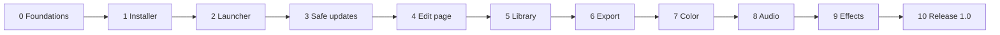

# Kiria — Build Plan

> Copied into the repository on 10 November 2026. From now on this file is the one to keep up to date; change it in the same commit as the code it describes.

## How to use this plan

Version 1.0 is built in ten phases plus a release phase, strictly in order; each phase ends at a gate that must pass before the next one starts. The [project plan](project-plan.md) says *what* the app is; this doc says *how* and *in what order* to build it. The agreed look is in the [mockups](https://claude.ai/artifact/BoWqShTxNag7Q1yD8BoKLr).

**Resuming work (people or Claude):**

1. Find the first phase in the table below that is not "Gate passed".
2. Open that phase and take its first unticked step.
3. Read `CLAUDE.md` and the `README.md` of every folder you will touch before writing code.
4. Finish the step (definition of done in the next section), tick it here, commit.
5. When every step in a phase is ticked, run its gate; only a passed gate, or the owner accepting the phase without it, moves the phase to "Gate passed".

**Changing the plan:** a new idea goes to "After 1.0" at the bottom unless it blocks the current gate. Changing an agreed decision means updating the project plan first, then this doc.



Every arrow is a gate: the phase before it is tested on both machines before the next one starts.

The platform (project file, errors, installs, safe updates) comes before any page, so every page is built on top of something that already can't lose work.

| # | Phase | Builds | Gate (short) | Status |
| --- | --- | --- | --- | --- |
| 0 | Foundations | Workspace, engine core, errors, resources, app shell | Empty app opens, autosaves, recovers from a forced crash | Gate passed |
| 1 | Installer and updates | Signed builds, installers, GitHub releases | A tagged build installs on a clean Windows and Linux machine | Gate passed |
| 2 | Launcher | Project browser, folders, update panel | Create, find and open projects; manual update works | Gate passed (accepted by the owner; manual gate tests skipped) |
| 3 | Update safety | Side-by-side installs, rollback, project migrations | A broken update rolls back by itself; old projects open | Gate passed (accepted by the owner; manual gate tests skipped) |
| 4 | Edit page | Media pipeline, playback, timeline, editing, inspector | Cut a 20-minute game recording smoothly at 1440p 60 | Not started |
| 5 | Library | Import, index, tabs, lists, labels, prune | 500 clips import, filter and search instantly | Not started |
| 6 | Export | Encode pipeline, presets, checks, queue | Exports match the timeline frame for frame | Not started |
| 7 | Color | Float pipeline, wheels, curves, scopes, auto white balance | Preview and export colours match; grades copy between clips | Not started |
| 8 | Audio | Mixer, effects, loudness, clarity check | A noisy three-track recording mixes to −14 LUFS cleanly | Not started |
| 9 | Effects and extras | Effects drawer, background removal, extra features | Hair edges hold, no flicker; extras pass their tests | Not started |
| 10 | Release 1.0 | Hardening, docs, licence, first public release | Release checklist all ticked | Not started |

## Ground rules and how each task is done

Every step follows the eight working rules in the project plan; the ones that change how code is written are repeated here so they are never missed.

- **Same control, same key, every page.** Shared tools (playhead, edit needle, region, labels, transport, shortcuts) live in one shared module and are reused, never re-implemented per page.
- **Shared visuals stay put.** Top bar, tab position (centred over the viewport), panel widths and theme tokens come from one layout and one theme module.
- **No other product names** in code, comments, docs, commit messages or UI text.
- **Documented folders.** Every crate and every folder with more than a couple of files has a `README.md` (what it holds, how it fits, entry points). `CLAUDE.md` in the root is the map of the whole project. Both are updated in the same commit as the code they describe.
- **Readable over clever.** Small modules, clear names, no `unsafe` outside the FFmpeg and GPU wrappers, no `unwrap()` in non-test code.
- **One name, one place.** The app name, short name, icon and identifiers live in `crates/brand`; nothing else hard-codes them.

### Workflow for a big system

Used for playback, caching, the timeline widget, rendering, the audio engine, background removal, auto white balance and the highlight finder (rule 7).

1. **Research:** short written note in `docs/research/<system>.md`: what the problem is, known approaches, sources.
2. **Prototype two or three approaches** in a throwaway `spikes/<system>/` folder, built in parallel (separate agents or branches), each against the same benchmark and test clips.
3. **Compare** on speed, smoothness, memory, code size and robustness; write the result and the choice into the research note.
4. **Build the chosen one properly** in its crate, delete the spike folder.

### Definition of done (every step)

- [ ] Builds without warnings on Windows and Linux (`cargo clippy -- -D warnings`).
- [ ] Tests for the new behaviour pass; existing tests still pass.
- [ ] Errors use the shared what / why / fix type, never a bare string.
- [ ] No UI-thread blocking: anything over 2 ms runs on a worker.
- [ ] Folder `README.md` and `CLAUDE.md` updated if structure or behaviour changed.
- [ ] Step ticked in this doc; commit message says what and why.

### Test footage

A shared `test-media/` folder (not in git; listed in `test-media/MANIFEST.md` with checksums) holds real recordings from both machines: 1080p 60, 1440p 144, variable frame rate, H.264, H.265 and AV1 from the AMD and NVIDIA encoders, MKV files with 3 audio streams, a 1-hour recording, a facecam clip, and a few deliberately broken files. Every phase gate is run against it.

## Repository layout and tooling

One Cargo workspace, one engine with no UI, and thin pages on top; the UI only sends commands to the engine and reads snapshots back, so a slow decode can never freeze a window.

```text
/
├─ CLAUDE.md               map of the project, rules, where things live, how to run
├─ README.md               public intro, build instructions, licence
├─ Cargo.toml              workspace, shared dependency versions
├─ crates/
│  ├─ brand/               app name, short name, icon, ids (the one place)
│  ├─ diag/                what/why/fix errors, logging, crash reports
│  ├─ project/             project model, commands, undo/redo, autosave journal
│  ├─ jobs/                worker pools, priorities, resource budgets
│  ├─ media/               probe, demux, decode, encode (FFmpeg wrapper)
│  ├─ cache/               RAM, GPU and disk caches, proxies, thumbnails, waveforms
│  ├─ render/              GPU compositor, transforms, colour, effects (wgpu)
│  ├─ audio/               real-time mixer, DSP, meters, loudness
│  ├─ ml/                  model inference (ONNX Runtime)
│  ├─ library/             media index and search (SQLite)
│  ├─ engine/              ties the above together: playback scheduler, export
│  ├─ ui-kit/              theme tokens, shared widgets, top bar, timeline widget
│  ├─ graphics/            which graphics system draws the windows: shared setting, safe start
│  ├─ app/                 the editor window and its five pages
│  ├─ launcher/            small separate binary: projects + updates
│  └─ updater/             release check, signature check, install, rollback
├─ docs/
│  ├─ research/            one note per big system (rule 7)
│  └─ decisions/           short records of decisions that changed the plan
├─ spikes/                 throwaway prototypes, deleted after a choice
├─ xtask/                  project chores: `cargo xtask check-media`
├─ tests/                  cross-crate and golden-frame tests
├─ test-media/             not in git, see MANIFEST.md
└─ .github/workflows/      CI and release pipelines
```

### Tooling

| Need | Choice | Notes |
| --- | --- | --- |
| Language | Rust stable, edition 2024 | Pinned with `rust-toolchain.toml` |
| Lint and format | `cargo clippy`, `rustfmt` | Warnings fail CI |
| Tests | `cargo nextest`, `proptest`, `insta` snapshots | Golden frames compared with a tolerance |
| Fuzzing | `cargo-fuzz` | Demuxer input and project files |
| Benchmarks | `criterion` | Tracked per commit, regressions fail CI |
| Licences | `cargo-deny` | Blocks dependencies with incompatible licences |
| Release | `cargo-dist` + GitHub Actions | Builds, signs and uploads on every tag |
| Profiling | `tracing` + Tracy | Spans on every job, frame and command |

### CI on every pull request

Windows and Linux runners: format check, clippy, tests, licence check, a 30-second playback benchmark on a reference clip. Tags `v*` additionally build installers, sign them and draft a GitHub release.

Linux is paused in CI and in releases since November 2026 (Windows only for now); the workflows keep the Linux steps and say how to turn them back on.

## Phase 0 · Foundations

Phase 0 builds everything later phases stand on and that is painful to add afterwards: the versioned project file, undo, autosave, explained errors, resource budgets and an empty themed window. No video yet.

**0.1 Repository and CI**

- [x] Create the GitHub repo, workspace `Cargo.toml`, `rust-toolchain.toml`, `.gitignore`, empty crates from the layout above.
- [x] Write `CLAUDE.md` (rules, layout, how to build, how to resume via this doc) and a `README.md` in every crate.
- [x] CI workflow: fmt, clippy, tests and cargo-deny on Windows and Linux (switch to nextest when the test suite grows).
- [x] `crates/brand`: name "Kiria", short name, app id, icon path; one unit test that nothing else contains the name string (grep test).
- [x] `test-media/MANIFEST.md` and a script that checks the files and checksums are present.

**0.2 Errors and logging (`diag`)**

- [x] `AppError { what, why, fix, action: Option<FixAction>, source }` with a builder; every crate returns it.
- [x] `tracing` setup: rolling log files in the user's data folder, 7 days kept.
- [x] Panic hook: writes a crash report (log tail, versions, GPU, OS) and marks the session as crashed.

**0.3 Project model (`project`)**

- [x] Data types: Project, Sequence, Track (video/audio), Clip, MediaRef (path + fingerprint), TimelineLabel, Region, edit needle position.
- [x] Time as rational numbers (`frames / rate`), never floats; frame-rate conversion helpers.
- [x] Persistent data structures (`imbl`) so a snapshot is a cheap clone.
- [x] Project file: RON with a `format_version` field from day one, written atomically (temp file, then rename).
- [x] Migration framework: one function per version step, tested with a stored v1 sample file.

**0.4 Commands, undo and autosave (`project`)**

- [x] Every change is a `Command` applied to a snapshot; undo/redo is a stack of snapshots.
- [x] Autosave journal: append each command to `project.journal`; full save every 30 s and on idle.
- [x] Recovery: on open, if the journal is newer than the save, replay it; offer "Recover" or "Open last save". (The engine side is done; the prompt itself is drawn by the launcher in 2.3.)
- [x] Property test: random command sequences + undo/redo always leave a valid project.

**0.5 Jobs and resources (`jobs`)**

- [x] Thread pools for decode, render, analysis and export; one thread always kept free for the UI.
- [x] Priorities: playback > interactive > background; background jobs pause while playing (setting).
- [x] Budgets for worker threads, RAM cache and disk cache, read from settings with Auto defaults.
- [x] Live usage numbers (CPU, GPU, RAM) published for the top-bar readout. (GPU use is filled in once the GPU layer exists.)
- [x] Full saves run on a worker: the interface hands out a snapshot, numbered journal entries make sure nothing is lost or applied twice.

**0.6 App shell (`ui-kit`, `app`)**

- [x] wgpu + egui window; Ash and Carbon theme tokens copied from the mockups; Inter and a monospace font bundled.
- [x] Shared top bar: project name left, page tabs centred over the viewport position, search button, resource readout, settings cog.
- [x] Empty pages for Library, Edit, Color, Audio, Export that switch instantly.
- [x] Shortcut system: one table of actions and default keys (Space, S, Delete, Backspace, M so far), used by every page.
- [x] Settings window skeleton: theme, resources, "Edit at the playhead".
- [x] Inline error display component (what / why / fix + button) and a Diagnostics panel listing the session's errors.

**Gate 0**

- [x] A new project opens, a dummy command changes it, undo and redo work, the file saves and reopens.
- [x] Killing the process mid-edit and reopening recovers every change.
- [x] An old-format sample project migrates and opens.
- [x] The window stays at the display refresh rate while a fake 8-second job runs in the background. (`--responsiveness-test`: slowest interface work 12.5 ms per frame on a software renderer; runs in CI.)
- [x] CI is green on Windows and Linux.

## Phase 1 · Installer and updates

Phase 1 makes every tagged commit a signed, installable release that the app can find and verify, so both of you run real builds from the first weeks instead of compiling locally.

**1.1 Packaging**

- [x] FFmpeg: a shared-library build (LGPL or GPL, both fit the project's GPL-3.0 licence) pinned to one version, fetched by a build script and bundled next to the binaries (Windows DLLs, Linux AppImage libs). Licence texts shipped in `licenses/`.
- [x] A Windows per-user installer (Inno Setup, see decision 0002) and a Linux AppImage, each containing both `app` and `launcher`.
- [x] Install layout: `<install>/versions/<x.y.z>/` holds each version; `<install>/launcher` stays outside it (needed for phase 3).
- [x] Start-menu / desktop entry points at the launcher, never directly at the editor.

**1.2 Signing**

- [x] Generate an ed25519 release key; private key only in GitHub Actions secrets, public key compiled into `updater`.
- [x] Release workflow signs a `manifest.json` (version, channel, file hashes, minimum launcher version).
- [x] Windows code-signing certificate: skipped for a hobby project (decision 0002); `RELEASING.md` explains the SmartScreen warning.

**1.3 Release check (`updater`)**

- [x] Query the GitHub Releases API with a 3-second timeout; Stable and Beta channels (Beta = pre-releases).
- [x] Download in the background with resume; verify every hash and the manifest signature before anything is unpacked.
- [x] Settings stored: automatic updates on/off, skipped version, channel.
- [x] Every failure becomes a what / why / fix error (offline, rate-limited, bad signature, disk full); none of them blocks opening.

**1.4 Release routine**

- [x] `RELEASING.md`: bump version, changelog entry, check CI, start the release; it publishes itself.
- [x] Version scheme: `0.x.y` until 1.0; the project file format version is separate and only goes up.

**Gate 1**

- [x] Tag `v0.1.0`: CI builds, signs and publishes a release with no manual steps. (Done 10 November 2026: draft "Kiria 0.1.0" with installer, AppImage, update package and signed manifest.)
- [x] The installer works on a clean Windows 11 machine and the AppImage on a clean Linux machine. (Automated: every release installs, starts and uninstalls on a fresh Windows runner and starts the AppImage on Ubuntu 22.04. Installed by the owner on Windows 11 on 10 November 2026; the AppImage gets its first run on your own Linux PC when Linux work starts.)
- [x] A tampered download is refused with a clear message.
- [x] With the network unplugged the app still starts within 4 seconds. (The launcher starts the editor before checking; measured under 0.1 s with no network.)

## Phase 2 · Launcher

Phase 2 builds the launcher exactly as in the agreed mockup: name and logo centred on top, folder tree on the left, a 3-wide project grid, and the version panel bottom left with Update, Skip this version and Automatic updates.

**2.1 Project index**

- [x] Small SQLite file in the user's data folder: known projects, path, thumbnail, length, settings, last opened, folder. (`crates/project-index`; thumbnails are read from beside the project file once the editor writes them.)
- [x] Projects found by: created here, opened from disk, or found in a watched project folder.
- [x] Reading a project's summary never loads the whole project (summary block at the top of the file). (`project::file::read_info` stops reading where the project starts.)

**2.2 Layout**

- [x] Top bar from `ui-kit` with the name and logo from `brand`, centred; settings cog right.
- [x] Left: folder tree with three groups (Projects, Media folders, Other folders) and "+ Add folder". Media folders are remembered for later import.
- [x] Main: "All projects", search, Open…, New project; 3-wide grid of 16:9 thumbnails, scrolling down; each card shows length, resolution, frame rate, last used and any issue line.
- [x] Bottom left: version, "x.y.z available", Update, Skip this version, Automatic updates tick box (wired to phase 1).

**2.3 Behaviour**

- [x] Choosing where projects are saved: a default folder (Settings, or right-click a folder) and Browse… for any folder in New project.
- [x] New project dialog with presets: Game clip (1080p 60), High frame rate (1440p 144), Vertical short (1080×1920 60), Match the first clip. (Changed in 4A: Automatic is the default and the others are optional templates.)
- [x] Issue checks before opening: file saved by a newer version, file damaged, project file missing. (Missing media with a relink suggestion moved to 4A, where importing arrives.)
- [x] Crash recovery prompt (from phase 0) shown here when the last session crashed. (Also on the card and when opening any project with unsaved crash work.)
- [x] Opening a project starts the editor process with the project path, then the launcher closes.

**Gate 2**

- [ ] Cold start to a usable launcher in under 1 second on both machines.
- [ ] Create, rename, move to a folder, search and open projects; 200 fake projects scroll smoothly.
- [ ] Newer-version, damaged and missing-file issues show on the right cards.
- [ ] Update, Skip and the Automatic tick box behave as labelled against a test release.

## Phase 3 · Update safety

Phase 3 makes a bad update harmless before real projects exist: new versions install beside the old one, a version that fails to start is rolled back by itself, and project files only ever move forward through tested migrations.

Automatic test builds (added in Phase 2 so features can be tried through updates): every push to `main` publishes a beta like `0.1.1-beta.12`, and beta builds follow betas.

**3.1 Side-by-side install**

- [x] New version unpacks to `versions/<new>/`; a small `current` pointer file switches only after unpacking and verifying. (`updater::apply`; the signature and checksum are checked again right before installing.)
- [x] Keep the previous two versions; delete older ones after a successful start.
- [x] "Use on next start" by default; "Update now" only when no project is open. ("Restart to update" in the launcher, which never has a project open.)

**3.2 Health check and rollback**

- [x] The editor writes "started OK" once its first window has drawn; the launcher waits up to 20 seconds.
- [x] Two failed starts in a row: switch the pointer back, mark the version as bad, explain what happened, offer to send the crash report. ("Report the problem" opens a new GitHub issue; "Show crash reports" opens the folder.)
- [x] A bad version is never offered again; the next good release is.

**3.3 Launcher self-update**

- [x] The launcher updates itself in a separate, rarer step, using a temporary copy so it can never break its own recovery. (Every version carries its launcher. It replaces the installed one only after that version has started properly, and only if it passes `--self-test`; the replaced launcher is kept aside until the new one has run.)
- [x] Manifest field "minimum launcher version" forces this step first when needed. (`brand::MIN_LAUNCHER_VERSION`.)

**3.4 Project safety across versions**

- [x] Before migrating a project, keep a copy as `<name>.backup-v<old>`.
- [x] A project saved by a newer version opens read-only with an explanation, never silently. (If the newer format changed too much to show, opening is refused with an explanation instead.)
- [x] Migration tests: every released format version has a stored sample that must open in the newest build (added to CI from now on). (`crates/project/tests/samples.rs`, run by `cargo test` in CI.)

**Gate 3**

- [ ] Ship a deliberately crashing test release on the Beta channel: both machines roll back on their own and show why.
- [ ] Pull the power during an update: the next start works on the old version.
- [ ] Sample projects from every earlier format version open, and a backup copy exists.

## Phase 4 · Edit page

Phase 4 is the heart of the app and the longest phase, so it runs as three parts with a checkpoint each: 4A plays media smoothly, 4B edits it on the timeline, 4C completes the page and its extras. Every shared timeline part (playhead, edit needle, region, labels, ruler, transport) is built once in `ui-kit` here and reused by Color and Audio later.

### 4A · Media and playback

- [x] **Probe and import:** container, streams, codec, frame rate, duration, rotation; MKV files with several audio streams import one track per stream, named after the stream. (`media::probe`; `Command::Import` places a file at the end of the timeline as one step; Ctrl+I, the Import button or dropping files. Project format 2 stores the streams.)
- [x] **Automatic project settings:** "Automatic" is the New project dialog's default and the presets become optional templates. In an Automatic project the first video imported sets size, frame rate and audio rate as one undoable step, and the app says what it chose; later clips are fitted, never change the settings silently. Settings stay changeable in the project. Project format change with a migration and a stored sample. (Project format 3; the launcher's dialog and cards; Timeline settings… on the Edit page.)
- [x] **Variable frame rate:** detect it on import, conform to the nearest constant rate, show what was done; audio must not drift over a 1-hour file. (`media::timing` reads packet times at three places; frames and sound are placed by their timestamps, so the drift check over a 1-hour file belongs to playback's checkpoint.)
- [x] **Decoding** (research workflow): hardware decode via D3D11VA / Vulkan Video / VAAPI on AMD and NVIDIA, software fallback, frames uploaded straight to GPU textures; compare at least two pipelines on the test footage. (Note and spike in `docs/research/decoding.md`. Built: GPU decoding with a copy back, CPU fallback per file, frames found by timestamp. The zero-copy path follows once measured on the test machine. Done towards it, step 1 of 3: on Windows the launcher's and the editor's windows draw through Vulkan, with Direct3D 12 as the fallback when Vulkan reports an error, crashes or freezes at start; after a crash or freeze the window asks whether to keep Direct3D 12 or try Vulkan again; one Graphics setting for both programs, in `crates/graphics`. Colour conversion now happens on the graphics card (step 2 of 3): the viewer uploads the decoder's YUV planes and a shader converts, scales and turns them while drawing; formats other than 8-bit 4:2:0 still convert on the CPU. Step 3 of 3, first half: with Vulkan, the editor opens its device itself with the video decode queues, so the decoder can share it; Diagnostics says which kinds of video the device decodes, or why none. Second half: the viewer's H.264, H.265 and AV1 video is decoded on that device and drawn from the graphics card without passing through system memory (a copy on the card into two plain images the shader samples; the reasons are in the note), falling back per file to the copy-back path and then the CPU; a switch in Settings under Graphics and a crash guard like the one around Vulkan turn it off. To be confirmed on the test machine; 10-bit, Linux and cards with a single queue family still go the older ways.)
- [x] **Audio clock as master:** `cpal` output with lock-free ring buffers; video frames scheduled against the audio clock. (`engine::playback`: the position is the samples played; a wall clock stands in without a sound card.)
- [ ] **Caches** (research workflow): RAM frame cache ahead of the playhead in the play direction, GPU texture cache, disk render cache keyed by input hash; budgets from phase 0. (Note and spike in `docs/research/caching.md`; measured on the cloud machine and on the test machine, where memory plus a proxy answered within 50 ms everywhere. Build order: dropping stale decodes and a key frame index (built: a click never waits for an earlier jump to finish, and a hop past a key frame jumps to it), frames kept after decoding (built for video decoded on the window's graphics device: every frame decoded on the way to a picture stays on the card within a budget, so going back over them is instant, and when idle the stretch before them is decoded too, so stepping back across a key frame is as well; the same for frames in memory is still to do), proxies, the key frame shown first. Built: where they will show. The timeline has a cache bar, a thin strip under the ruler (`ui_kit::timeline::cache_bar`) that draws ready, being-prepared and waiting stretches from ranges the page passes in. Today the Edit page feeds it only with what really is prepared in the background, the reading of waveforms and clip pictures, and marks nothing as ready: pictures for playback are still decoded as they are needed, so a green stretch would promise smooth playback that nothing guarantees. To feed it when built: the RAM frame cache (ready where frames are in memory around the playhead), proxies (being prepared while a file's proxy is built, ready when it exists), and the disk render cache and the region's pre-render (ready where rendered). They only add ranges; the widget stays as it is.)
- [ ] **Thumbnails, waveforms and proxies** built in the background; proxy Off / On / Auto; export always uses originals. (Waveforms and clip thumbnails done; proxies still to do: what to build is in `docs/research/caching.md`. While a file's sound or pictures are being read the timeline says so: each clip still waiting has a slim bar with the percentage and, once it can be told steadily, the time left; an audio clip's waveform fills in from the left as the reading goes; the track's name has "Reading 43 %" beside it until all its clips are done; clips whose reading failed say "no waveform" or "no pictures". Jobs report progress through `jobs::JobContext::set_progress`, one atomic number per job, which proxies and exports can use too. Closing the app or relinking a file stops readings still under way.)
- [x] **Project thumbnails:** the editor writes one on every save; the launcher's cards show it (moved here from phase 2: there is no picture to show before playback). (Done: the frame at the playhead, written on a worker after each save and on closing; the launcher reads it on a worker.)
- [x] **Missing media:** the launcher's cards and the editor say which clips are missing and suggest relinking them (moved here from phase 2: there is no media before importing). (Done: the Edit page says which files are missing, marks their clips, and finds them in a picked folder by fingerprint, even renamed; the launcher's cards count them.)
- [x] **Preview quality:** Full, 1/2, 1/4, Auto; drop resolution before dropping frames; the viewport says when and why. (Auto lowers to 1/2 and then 1/4 while playing when pictures arrive late, and the viewer's corner says so; full again when paused. Since colour conversion moved to the graphics card, that lowering only applies to pictures still converted on the CPU; the others come at the nearest halving of the file's size that fills the size wanted, which costs the same at any setting.)
- [ ] **Viewport and transport:** single view, Display menu, preview-resolution dropdown, zoom; floating squircle transport with play centred; pause returns to where playback started, stop holds; Space plays/pauses. (Done: preview-resolution menu, the floating transport, Space, pause back to start, stop holds. A handle between the viewer and the timeline shares the height between them: drag it down for a taller viewer, up for a taller timeline, double-click for the usual split; kept in Settings, and a shared part (`ui_kit::splitter`) for the Color and Audio pages to use. Still to do: Display menu, zoom.)

**Checkpoint 4A:** a 1440p 60 H.265 recording plays in real time on both machines, scrubbing shows a frame within 50 ms, and a 1-hour VFR file stays in sync to the end.

### 4B · Timeline and editing

- [x] **Timeline widget** (research workflow): one custom GPU-drawn widget, not stacked UI elements; video area and audio area with separate vertical scroll, a draggable divider, shared ruler starting at 00:00:00:00, bottom scroll bar with zoom. (`ui_kit::timeline`; measured in `docs/research/timeline.md`.)
- [x] **Moving around the timeline:** zoom in for fine work and out for the whole edit, pan sideways, scroll each area, the same over the ruler and both areas. (Done: Ctrl+wheel or a pinch zooms time and keeps the moment under the pointer in place; `=`, `+` and `-` zoom in and out around the playhead; `\` shows everything. Shift+wheel, a sideways wheel or two fingers on a touchpad pan; the plain wheel scrolls the area under the pointer and pans over the ruler and the scroll bar; dragging with the middle button pans time and scrolls the area it began over. Zoomed all the way in, a frame is at least 40 points wide at any frame rate and the ruler has a mark on every frame. Ctrl+wheel and Shift+wheel had stopped working: the interface library hands them over as a zoom factor and as sideways scrolling, which the widget now reads; input tests cover every gesture.)
- [x] **Clips:** video clips share one fill with a label-coloured top edge; each audio track has its own colour; waveforms drawn from the cache. (Done: shared fill with a top edge, a colour per audio track. Waveforms are read once per stream by `cache::waveform`.)
- [x] **Edit commands** (all undoable): insert, overwrite, move, trim, delete (Delete, leaves gap), ripple delete (Backspace, closes gap), split (S: selected clip's video and linked audio, or every track when nothing is selected). (Done: insert and overwrite at the edit point from the media drawer's right-click menu, dragging a file onto the timeline (over what's there; Ctrl inserts), move and trim by dragging, delete, ripple delete, split.)
- [ ] **Tools as icons:** select, blade, ripple, roll, slip, slide, text; magnetic snapping (N). (Done: select (V), blade (B), ripple (R), roll (T), slip (Y), slide (U), snapping (N). The text tool comes with titles.)
- [x] **Red edit needle:** separate from the playhead, draggable, its timecode beside the playhead's; cuts, splits and pastes happen there; setting "Edit at the playhead" merges them. (Dragged by its handle in the ruler; its timecode in red beside the playhead's.)
- [ ] **Region:** dragged in the ruler; filled half-circle handles, muted bar, everything outside darkened; loop (L), pre-render, reuse as export range. (Done: Shift-drag in the ruler, round handles, darkened outside, loop with L, set to a clip or cleared from the right-click menu. Pre-render and export range wait for the caches and the Export page.)
- [ ] **Timeline labels:** right-click menu and M place one at the edit needle; Labels row under the ruler; label the region; search finds labels. (Done: M, the right-click menu, the Labels row, search jumps to them; click a label to go there, double-click to rename, recolour or remove it. Labelling the region comes with the Export page's ranges.)
- [x] **Rough cut view:** Display › Timeline: Full / Rough cut; one strip per clip with picture and sound together. (Done: Ctrl+Shift+T or the toolbar; each video clip shows its pictures with its linked sound underneath, sound that belongs to a picture leaves the audio area, and every tool works the same. Kept in Settings.)
- [ ] **Track headers:** per-track horizontal fader, mute, solo; master column right of the timeline whose meter is also the fader, with LUFS and true peak. (Done: mute, solo and a volume fader on audio tracks; the master column with a meter that is also the mix's fader, and momentary and short-term loudness. True peak (oversampled) still to do: the meter shows sample peaks.)
- [x] **Track heights:** every track as tall as the work needs: tall audio tracks for fine waveform work, tall video tracks for bigger pictures. (Done: drag the edge of a track's name, the bottom edge of an audio track and the top edge of a video track; double-click it for the usual height; Alt+wheel, or Alt with `=` and `-`, makes every track of the area under the pointer taller or shorter and Alt+`\` puts them back; 28 to 400 points. Waveforms, pictures, the rough cut view, scrolling and every tool follow the heights. Heights are view state, not edits: no undo step, no unsaved change. They are kept with the divider between video and audio in `<project file>.view` beside the project, so they come back when it is reopened, need no change to the project format, and a project without the file simply opens with the usual layout.)

**Checkpoint 4B:** cut a 20-minute recording into a 3-minute edit using only the keyboard shortcuts, undo the whole session step by step, and the timeline never drops below the display refresh rate.

### 4C · Page completion and extras

- [x] **Compositor** (`crates/render`): the timeline's picture put together on the GPU from every visible layer (place, crop, opacity, quick colour), at the timeline's size; the viewer shows it and export will read it. Everything below that changes the picture is built on it. (Done: researched, measured on the test machine and chosen, `docs/research/rendering.md`. The preview worker decodes every layer that is seen and puts them together in linear light on the window's device (`engine::frame`, `engine::compose`, `render::Compositor`); the viewer shows that one frame, in the timeline's shape. A clip that doesn't fill the frame gets bars and lets lower tracks show; layers hidden by a frame-filling clip are never decoded. Still to do: place, crop, opacity and quick colour per clip (the inspector, next); the saved frame and the project's picture still show the top clip alone; a window not drawn on a graphics card shows the top clip alone.)
- [ ] **Inspector** (right, fixed width): Transform, Crop, Quick color, Speed, Effects, Audio; one-line summaries in collapsed headers; keyframe diamonds. (Done: the panel on the right of the Edit page for the selected clip, with Transform (position, size, turn, opacity, Fit and Fill), Crop, Quick color (exposure, contrast, saturation, temperature, tint) and Speed; headers say what is set in one line and offer Reset; a drag shows in the viewer at once and is one undo step. Each clip's values are its `look` in the project file (format 8), in millionths. Still to do: Effects and Audio sections, keyframe diamonds, handles on the picture itself, several clips at once; the saved frame and the project's picture don't follow the look yet.)
- [ ] **Split view:** Source (raw clip) beside Program (final), off by default, from the Display menu.
- [x] **Media pool drawer:** left edge tab sliding out a compact media list (full library comes in phase 5) with the Media / Effects switch in place. (Done: the Media tab on the left edge; files by name with a filter, missing ones marked; double-click or + places one at the end of the timeline. Dragging onto the timeline comes with insert and overwrite.)
- [ ] **Search palette** (Ctrl K): clips, labels, timeline labels, commands, settings; shows each command's shortcut. (Done: commands with shortcuts, Settings and Timeline settings, timeline labels and clips (jump there; a clip is also selected). Library clips and labels join with the Library page.)
- [ ] **Slow motion and speed ramps:** speed per clip, ramp keyframes, frame blending; high-frame-rate sources slow down cleanly. (Done so far: a speed per clip from its right-click menu, 25% to 400%, exact fractions; picture and sound follow it, the sound tape-style. Still to do: ramps, frame blending, keeping the pitch.)
- [ ] **Nested timelines and several timelines per project;** adjustment layers.
- [ ] **Facecam layouts:** picture-in-picture and vertical game-plus-facecam presets with on-picture handles.
- [x] **Remove silence:** detect silence on a chosen track, preview the cuts, apply as one undoable command. (Done: Ctrl+Shift+R; threshold, minimum length and edge to keep; found stretches marked red on the timeline; one undoable cut across every track.)
- [ ] **Saved versions, templates, thumbnail grab:** named project snapshots, intro/outro templates, save any frame as a full-quality image. (Done: thumbnail grab, Ctrl+Shift+E saves the frame at the playhead as a full-size PNG; saved versions, Ctrl+Shift+V, kept beside the project and restored as an undoable step. Templates still to do.)
- [ ] **Comfort:** viewer on a second monitor or full screen, per-project cache cleanup. (Done: F puts the viewer full screen, Escape returns. The second monitor still to do. Cache cleanup waits for a cache on disk: waveforms and clip thumbnails are kept in memory per media file and go when the editor closes, so there is nothing to clean yet. When the disk cache and proxies arrive in phase 4A's caching work, cleanup comes with them, and anything they keep per project joins `project::side_files`.)
  - [ ] **Keyboard shortcuts page** (Settings, or "shortcuts", "keybinds", "hotkeys" or "keys" in search): visual keyboard drawn for the layout detected from the operating system (Windows keyboard-layout API, Linux xkbcommon), with the right key shapes (ISO, ANSI, JIS) and printed characters, following layout switches live, a dropdown as manual override; shortcuts stored by physical key position so they work on every layout, non-Latin keys showing both their character and the shortcut letter; test on Norwegian, US English, Arabic and Russian layouts; search box, coloured context chips as filters, coloured dots on each used key, dimmed unused keys, Shift / Ctrl / Alt redraws combinations, point to preview and click to pin a key's actions, a Mouse section below; rebinding with clash warnings and a printable cheat sheet, all generated from the one shortcut table. (Done so far: Ctrl+/, Settings or search ("shortcuts", "keybinds", "hotkeys", "keys") open it; a drawn keyboard with used keys tinted and dotted in their context's colour and the rest dimmed, Ctrl / Shift / Alt toggles, point or click a key to see its commands, a search box that narrows the list and lights the keys it finds. Context chips (Anywhere, Viewer, Timeline, While dragging) filter the keyboard, the list and the mouse section. Rebinding: click a command's keys in the list (or pin a key and choose Change…), then press the new keys or click them on the drawing; keys another command has say whose they are and offer Swap or Cancel, so no two commands ever share a combination; Reset per command and Reset all; a command can be left without a shortcut or given one. Changes are in the one shortcut table, so menus, tooltips, hints, search and the launcher show and use them at once; only what differs from the usual keys is kept in settings, by key position. A Mouse section lists wheel, drag, click and held-key actions by context (shown, not changeable). "Cheat sheet…" saves one self-contained HTML page to print: a keyboard picture per modifier combination in use, every command by context with its current keys, and the mouse. The keyboard is drawn in the right shape (ANSI, ISO with the tall Enter and the key by the left Shift, JIS) with the layout's characters, and the US character beside any that differs; built in are US, UK, Norwegian and Japanese, picked from a dropdown and remembered. Still to do: reading the layout from the system and following switches live (the lookups from a Windows language identifier and an XKB name are there and tested; the call that asks Windows is a foreign call, which needs `unsafe`, kept out of `ui-kit` and `app` by working rule 6, so it wants a decision on where it may live); more layouts, Arabic and Russian among them, with the tests on those; shortcuts in menus and tooltips written with the layout's characters; contexts that are not live together (Color page, Audio page, Menus and dialogs), which is when one combination may do different things in different places.)

**Launcher follow-up (after the edit page)**

- [x] **Delete project:** right-click a card › Delete project…; the confirmation lists the files. The project file and the files that belong to it (journal, backups, thumbnail, timeline layout, saved versions, caches) go to the recycle bin, so a mistake can be undone; imported recordings are never touched. (Done: the list of a project's files is in one place, `project::side_files`; renaming and moving a project now carry them all too. No caches are on disk yet, so none are listed. A project open in the editor is refused.)

**Gate 4**

- [ ] Both of you edit a real 20-minute game recording at 1440p 60 to a finished cut without a stutter, crash or lost change.
- [ ] Every shortcut and tool behaves the same in Rough cut and Full views.
- [ ] Performance targets from the project plan are met and recorded in the benchmark history.

## Phase 5 · Library

Phase 5 turns the simple media list from phase 4 into the full Library page and gives long recordings a head start with the highlight finder; the same index also powers the Edit page's media drawer.

**5.1 Index and search (`library`)**

- [ ] SQLite tables: media, types, labels, custom lists, notes, usage in timelines; full-text search across names, labels and notes.
- [ ] Import checks every file first and explains anything unsupported (codec, damaged, too new) before it reaches a timeline.
- [ ] Media folders from the launcher are watched; new recordings show up on their own.

**5.2 Page layout (as in the mockup)**

- [ ] Same top bar and tab position as every page.
- [ ] Left: labels, smart filters, Import, Prune.
- [ ] Tab bar: Video, Audio, Images, Effects, then custom lists with "+ New list"; the bar fades and scrolls when full.
- [ ] Filter row: label chips, group by, sort, thumbnail size, grid / list switch.
- [ ] Video, Images, Effects: thumbnail grid grouped by label, coloured label edge, "In timeline" and "Needs proxy" badges.
- [ ] Audio: rows with play button, name, full-width waveform in label colour, format, used-in-timeline mark, duration; grouped by label.
- [ ] Detail panel (right, same width as the Edit inspector): preview, mark in/out, add to timeline, metadata, labels, lists, notes; for audio a large waveform, loudness and true peak with one-click fixes.

**5.3 Media management**

- [ ] Prune: list unused media first, remove it from the project in one undoable step, never delete files from disk.
- [ ] Relink: by fingerprint, automatically when files moved inside a known folder.
- [ ] Package project: copy the project plus only the media it uses into one folder (with progress and size shown first) that opens on the other person's machine.

**5.4 Highlight finder** (research workflow)

- [ ] Background analysis on import of long recordings: mic loudness bursts, game-audio spikes, scene changes, sudden motion.
- [ ] Results become suggested timeline labels on the clip, shown faded until accepted; accept or dismiss one by one or all at once.
- [ ] Sensitivity setting; tested on at least five recordings from different games, with false positives counted.

**Gate 5**

- [ ] 500 mixed files import with live progress while the UI stays smooth; filters and search answer in under 100 ms.
- [ ] A packaged project opens on the other machine with nothing missing.
- [ ] The highlight finder marks at least the moments both of you would pick in a 30-minute test recording.

## Phase 6 · Export

Phase 6 delivers finished files: the full Export page from the mockup, a background queue, and output that matches the timeline frame for frame and sample for sample.

**6.0 Basic export, pulled ahead of the Library** (decided November 2026: until a video can be got out, nothing made on the Edit page can be used; so this one step is built right after the Edit page's inspector, and the rest of the phase keeps its place)

- [x] Export the timeline, or its region, to one MP4 file: H.264 from the graphics card's encoder with a software fallback, AAC sound, at the timeline's size and frame rate. Pictures come from originals through the same compositor as the viewer, sound from the same mixer. It runs on a worker with progress, time left and cancel, and editing continues meanwhile. A small dialog (file, range, quality) stands in for the Export page; presets, the queue, other formats, loudness and the checks are 6.1 and 6.2. (Done: the Export page has the file, the whole timeline or the region, High / Medium / Small with the size each comes to, and the encoder (the graphics card's when one opens, else the processor's); progress says the frame, the pace against real time, the time left and which encoder; Cancel leaves nothing behind. `media::encode`, `render::Reader`, `engine::export`. Not yet measured on the test machine: the pace, and that the card's encoder opens.)

**6.1 Encode pipeline (`engine`, `media`)**

- [ ] Render the timeline from originals (never proxies) through the same compositor as playback, at full quality.
- [ ] Hardware encoders first (AMD AMF / VA-API, NVIDIA NVENC) for H.264, H.265 and AV1; software fallback.
- [ ] Containers MP4 and MKV; audio AAC, Opus, FLAC; audio-only WAV, MP3, OGG.
- [ ] Loudness normalisation pass (two-pass measure, then apply) and a true-peak limiter on the master.

**6.2 Page (as in the mockup)**

- [ ] Presets left: Web 1080p, Web 4K, Vertical, Archive master, Small preview, Audio only, plus saving your own.
- [ ] Settings middle: file name, folder, range (whole timeline, in to out, or the region), video and audio settings, separate WAV option.
- [ ] Checks: missing media, loudness and peaks, unrendered effects with "Render now", disk space.
- [ ] Summary right in plain words: size, time on this machine, what it plays on, Export / Add to queue.
- [ ] Queue along the bottom: background exports with progress, time left, pause, cancel; editing continues.

Chapters from labels and one file per label were not picked for 1.0; they wait in "After 1.0" unless you add them.

**Gate 6**

- [ ] Golden-frame test: exported frames match the preview within tolerance on both GPUs.
- [ ] Audio and video stay in sync to the frame over a 1-hour export.
- [ ] Every preset plays in a standard media player and uploads to a video site without re-encoding warnings.
- [ ] Exporting a 10-minute 1440p 60 timeline takes no longer than its real time on either machine with hardware encoding.

## Phase 7 · Color

Phase 7 builds the grading pipeline and the Color page from the mockup: one tool at a time, the picture and one scope, Simple and Advanced wheels, and colours that look the same after export as in the viewer.

**7.1 Pipeline (`render`)**

- [ ] 32-bit float, linear light, on the GPU; input transform per clip (Rec.709, sRGB), output Rec.709.
- [ ] A grade = an ordered list of nodes (layers) per clip, stored in the project, cached in the render cache.
- [ ] Operations: exposure, contrast + pivot, temperature / tint, lift / gamma / gain / offset, saturation, highlights, shadows; curves (RGB, per channel, hue vs hue, hue vs saturation, luma vs saturation); HSL qualifier with soft edges; ellipse, rectangle and freehand masks; .cube LUTs with an intensity slider.
- [ ] Scopes computed on the GPU from the real output: waveform, RGB parade, vectorscope, histogram, plus a one-line plain reading ("nothing is clipped").

**7.2 Auto white balance** (research workflow)

- [ ] Compare at least two statistical methods and one small learned model on facecam and game clips.
- [ ] Chosen method: several frames across the clip, linear light, ignores clipped, near-black and strongly saturated pixels.
- [ ] Writes into the temperature and tint sliders; strength slider; the "pick something white" eyedropper overrides it; never runs on its own.

**7.3 Page (as in the mockup)**

- [ ] Large viewport with Compare and Display menus; one scope on the right with a dropdown.
- [ ] Tool switcher under the picture: Basic, Wheels, Curves, Color range, Masks, Looks; only one shown.
- [ ] Layer dropdown; Simple / Advanced toggle next to it.
- [ ] Simple wheels: white balance left, four wheels (Shadows, Midtones, Highlights, Overall) with brightness sliders, tone right. Advanced: large wheels with typed R, G, B and brightness values.
- [ ] Timeline: video clips with a dot on graded ones, all audio as one view-only bar; Apply to (this clip, all clips with a label, whole timeline), Copy grade, Paste, Match to, Reset.
- [ ] Transport steps clip by clip as well as frame by frame; shared playhead, edit needle, region and labels from phase 4.

**Gate 7**

- [ ] Golden-frame tests: preview, scopes and export agree within tolerance on both GPUs.
- [ ] A grade copied to 50 clips applies instantly and plays in real time after caching.
- [ ] Auto white balance fixes a warm-lit facecam clip and leaves a deliberately tinted game clip almost untouched.

## Phase 8 · Audio

Phase 8 builds the audio engine's effects and the Audio page from the mockup: video preview top left, one effect at a time top right, the clarity check across the middle, and a Timeline / Mixer / Split view at the bottom that scales to dozens of tracks.

**8.1 DSP (`audio`)** (research workflow for the engine)

- [ ] Real-time thread with no allocations or locks; every effect processes fixed-size blocks; tested with a stress run of 32 tracks.
- [ ] Per track: high-pass filter, parametric EQ with an analyser overlay, compressor (threshold, ratio, attack, release, knee, makeup, gain-reduction meter, plain presets), noise clean-up, ducking (sidechain under dialogue), loudness.
- [ ] Master: compressor, true-peak limiter; meters for integrated, short-term and true-peak loudness.
- [ ] Volume and pan automation lines, drawn on clips and tracks.

**8.2 Clarity check**

- [ ] Worker-thread analysis of where tracks share frequencies at the playhead and over the region.
- [ ] Muddy zones highlighted, explained in plain words, with one-click fixes (lower music under dialogue, cut music around 300 Hz).

**8.3 Sync by sound**

- [ ] Cross-correlate waveforms to line up a separately recorded mic or friend's recording with the game recording; show the offset found and a confidence; one undoable step.

**8.4 Page (as in the mockup)**

- [ ] Top left: video preview with transport. Top right: track dropdown + one-at-a-time switcher (EQ, Compressor, Clean-up, Ducking, Loudness), each with its graph, settings and one plain sentence of what it is doing.
- [ ] Bottom: Timeline, Mixer, Split toggle; Split side by side by default, stacked as an option; Show filter (all, dialogue, music, SFX and foley, ambience).
- [ ] Mixer strips: meter that doubles as fader, exact dB box, effect tags, mute, solo; strips scroll sideways, master pinned right.
- [ ] Shared playhead, edit needle, region, labels, transport and shortcuts from phase 4.

**Gate 8**

- [ ] A noisy recording with game, mic and voice chat streams mixes to −14 LUFS integrated with no true peak over −1 dB.
- [ ] 32 tracks with effects play without a single audio dropout on either machine.
- [ ] Sync by sound lines up a separate mic recording to within one frame.

## Phase 9 · Effects library and background removal

Phase 9 fills the Effects side of the Edit page's drawer and ships background removal that holds up on hair and motion; nothing here adds a page.

**9.1 Effects drawer**

- [ ] Media / Effects switch; group list left (Favourites, Recently used, Video transitions, Audio transitions, Titles, Motion, Keying, Stabilise, Blur and censor, Stylise, Overlays, Audio effects).
- [ ] Larger rows with a preview thumbnail, grouped under collapsible headings; a setting switches to a grid of tiles.
- [ ] Drag onto a clip or a cut; hovering an effect previews it on the selected clip.
- [ ] Settings appear in the inspector's Effects section and are tuned on the picture wherever possible.

**9.2 First effects** (each a small GPU shader or DSP module with a test)

- [ ] Transitions: cross dissolve, dip to black/white, wipe, push, zoom; audio crossfade.
- [ ] Titles: lower third, centred title, end card; text tool from phase 4.
- [ ] Motion: zoom to a point, shake, smooth pan.
- [ ] Stabilise (tracking-based), blur and pixelate with a tracked box for censoring names and chat.
- [ ] Stylise: vignette, film grain, sharpen, glow. Overlays: image and video on top with blend modes.

**9.3 Background removal** (research workflow, `ml`)

- [ ] Evaluate two or three open video-matting models on your own facecam footage; check their licences fit the project.
- [ ] Run through ONNX Runtime on the GPU (DirectML on Windows, CUDA / ROCm where available), CPU fallback.
- [ ] High-resolution edge refinement, temporal smoothing with a strength slider, add/remove brushes, edge softness, choke/expand, spill suppression, matte view.
- [ ] Mattes computed once in the background and stored in the render cache, so playback is real time afterwards.

**Gate 9**

- [ ] Background removal on the difficult-clips set (hair against busy backgrounds, fast motion, low light): no visible flicker and clean hair edges at full resolution.
- [ ] Every effect works the same in preview and export (golden frames) and undoes cleanly.
- [ ] The drawer opens and closes without moving anything underneath it.

## Phase 10 · Release 1.0

Phase 10 adds no big features: it polishes, settles the two open decisions, and makes the project ready for strangers to install, use and contribute to.

**Decisions that must be made before the first public release**

- [ ] App name: Kiria, confirmed free in TMview (classes 9 and 42, EU, Norway, UK, US), domain and GitHub organisation secured, set in `crates/brand` (one-line change), icon made.
- [x] Licence: GPL-3.0-or-later chosen and `LICENSE` added (November 2026); FFmpeg build checked against it in Phase 1.

**Hardening**

- [ ] Interface scaling for high-resolution screens; label colours checked for colour-blind users.
- [ ] Fuzzing runs for 24 hours on the demuxer and project parser with no crash.
- [ ] Media corpus: every file in `test-media/` imports, plays and exports, or fails with a clear explained error.
- [ ] Memory: a 4-hour editing session on both machines with no growth beyond the cache budgets.
- [ ] Every error message read through once for plain wording and a working fix button.

**Release checklist**

- [ ] `README.md` with screenshots, install steps and system requirements; `CONTRIBUTING.md`; every folder README current; `CLAUDE.md` current.
- [ ] Code-signing certificate in place for Windows; AppImage tested on two Linux distributions.
- [ ] Changelog from 0.1 to 1.0; tag `v1.0.0` on the Stable channel.
- [ ] Manual smoke test on both machines: install, launcher, import, cut, grade, key, mix, export, update to a 1.0.1 test build.

## After 1.0

Ideas that are agreed as worth doing but deliberately not in 1.0. Anything new that comes up during the build goes here first.

- Automatic captions and edit by transcript.
- Chapters from timeline labels; one exported file per label.
- macOS build.
- HDR and camera log footage.
- Multicam editing.
- Plugin API.
- Working on the same project together (sync, shared libraries).
